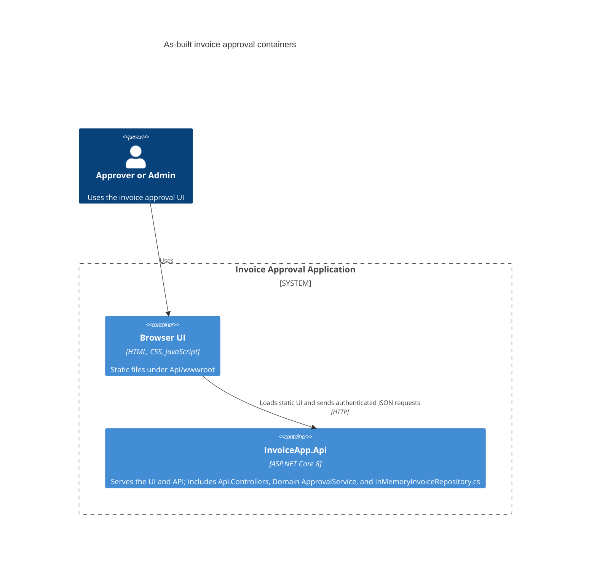
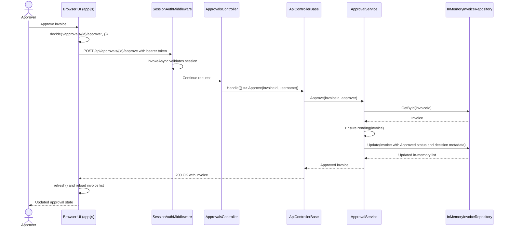

# Invoice Approval Architecture

## As-built C4 Container diagram

The browser UI is served as static files by the same ASP.NET Core API process. Controllers and domain services run in that process; invoice data is held in an in-memory repository, not a separate database.

**Source note:** `backend/src/InvoiceApp.Api/Program.cs` top-level statements call `app.UseDefaultFiles()` and `app.UseStaticFiles()`, map controllers, and register `IInvoiceRepository` to `InMemoryInvoiceRepository` and `ApprovalService`; `backend/src/InvoiceApp.Api/InMemoryInvoiceRepository.cs` class `InMemoryInvoiceRepository` stores invoices in `List<Invoice>` and implements `GetAll`, `GetById`, `Add`, `Update`, and `Remove`; `backend/src/InvoiceApp.Api/Controllers/InvoicesController.cs` class `InvoicesController`; `backend/src/InvoiceApp.Api/Controllers/ApprovalsController.cs` class `ApprovalsController`; and `backend/src/InvoiceApp.Api/wwwroot/app.js` functions `api`, `refresh`, and `decide`.



There is no SQL database or separate repository process in this as-built view. `InMemoryInvoiceRepository` uses a process-local list; its data is not durable across application restarts.

## As-built approval sequence

This sequence follows an approval request. The sign-in middleware validates the bearer session before the controller; approval state is then read and updated through the in-memory repository.

**Source note:** `backend/src/InvoiceApp.Api/wwwroot/app.js` functions `decide` and `api`; `backend/src/InvoiceApp.Api/Auth/SessionAuthMiddleware.cs` method `SessionAuthMiddleware.InvokeAsync`; `backend/src/InvoiceApp.Api/Controllers/ApprovalsController.cs` method `ApprovalsController.Approve`; `backend/src/InvoiceApp.Api/Controllers/ApiControllerBase.cs` method `ApiControllerBase.Handle`; `backend/src/InvoiceApp.Domain/ApprovalService.cs` methods `ApprovalService.Approve`, `Find`, and `EnsurePending`; and `backend/src/InvoiceApp.Api/InMemoryInvoiceRepository.cs` methods `InMemoryInvoiceRepository.GetById` and `Update`.



## Agent Inferences

These are plausible assumptions an agent might make before checking the source; the corrections are grounded in the current repository:

| Initial assumption | Code reality |
|---|---|
| An Azure SQL database or other SQL database persists invoices. | No SQL persistence is implemented. `backend/src/InvoiceApp.Api/InMemoryInvoiceRepository.cs`, class `InMemoryInvoiceRepository`, stores invoices in a process-local `List<Invoice>`. |
| A PayEx payment integration runs during approval. | No PayEx integration is implemented. `backend/src/InvoiceApp.Domain/ApprovalService.cs`, method `Approve`, updates invoice status and decision metadata only. |
| The repository is a separately deployed service or database. | `InMemoryInvoiceRepository` is registered in the API process by `backend/src/InvoiceApp.Api/Program.cs`; it is not an external container. |
| The application already uses a Transactional Outbox or message broker. | No outbox, broker, or background dispatcher is registered in `Program.cs` or implemented in the inspected workflow. |
| Invoice amounts use binary floating-point. | `backend/src/InvoiceApp.Domain/Invoice.cs`, property `Invoice.Amount`, is `decimal`; the API create request also uses `decimal` in `InvoicesController.CreateInvoiceRequest`. |
| Approvals are processed asynchronously. | `ApprovalsController.Approve` calls `ApprovalService.Approve` in the request path and returns its result through `ApiControllerBase.Handle`. |

## Target-state sequence (proposed, not implemented)

The following is a hypothetical design showing how an approval could atomically persist its state change and a payment-request outbox event, then dispatch the event to PayEx. **Azure SQL, the transactional outbox, its dispatcher, and the PayEx client do not exist yet.** The current approval request does not call any payment provider.

**Source note:** The existing entry point is `backend/src/InvoiceApp.Api/Controllers/ApprovalsController.cs`, method `ApprovalsController.Approve`, and the current state change is `backend/src/InvoiceApp.Domain/ApprovalService.cs`, method `ApprovalService.Approve`; current repository persistence is `backend/src/InvoiceApp.Api/InMemoryInvoiceRepository.cs`, method `InMemoryInvoiceRepository.Update`. Azure SQL, outbox records and transaction handling, a dispatcher, and PayEx have no supporting implementation symbols in this repository; they are proposed elements marked below.

```mermaid
sequenceDiagram
    actor Approver
    participant UI as Browser UI
    participant API as InvoiceApp.Api (existing; persistence changes proposed)
    participant SQL as Azure SQL [DOES NOT EXIST YET]
    participant Dispatcher as Outbox dispatcher [DOES NOT EXIST YET]
    participant PayEx as PayEx client/provider [DOES NOT EXIST YET]

    Approver->>UI: Approve invoice
    UI->>API: POST /api/approvals/{id}/approve
    Note over API,SQL: Proposed transactional persistence; neither SQL nor outbox exists in the codebase
    API->>SQL: Begin transaction; update invoice and insert payment-request outbox event [DOES NOT EXIST YET]
    SQL-->>API: Commit both writes atomically
    API-->>UI: Return approval result
    Note over Dispatcher,PayEx: Proposed asynchronous dispatch; neither component nor integration exists yet
    Dispatcher->>SQL: Claim unpublished outbox event
    SQL-->>Dispatcher: Payment-request event
    Dispatcher->>PayEx: Send payment request
    PayEx-->>Dispatcher: Payment outcome
    Dispatcher->>SQL: Record delivery and payment outcome
```

This proposal would need explicit idempotency and retry/reconciliation behavior: committing an outbox event atomically with invoice state does not make the later external PayEx operation exactly-once. The diagram is a target-state proposal, not a description of current behavior.

## Test command and terminal output

Run from the ackend\ directory, which contains InvoiceApp.sln:

```powershell
dotnet test --filter "FullyQualifiedName~ArchitectureTests" --verbosity normal
```
```text
Build started 30-10-2026 20:20:34.
     1>Project "G:\ai-in-sdlc-assignment\backend\InvoiceApp.sln" on node 1 (Restore target(s)).
     1>ValidateSolutionConfiguration:
         Building solution configuration "Debug|Any CPU".
       _GetAllRestoreProjectPathItems:
         Determining projects to restore...
       Restore:
         X.509 certificate chain validation will use the default trust store selected by .NET for code signing.
         X.509 certificate chain validation will use the default trust store selected by .NET for timestamping.
         Assets file has not changed. Skipping assets file writing. Path: G:\ai-in-sdlc-assignment\backend\src\InvoiceApp.Domain\obj\project.assets.json
         Assets file has not changed. Skipping assets file writing. Path: G:\ai-in-sdlc-assignment\backend\tests\InvoiceApp.Tests\obj\project.assets.json
         Restored G:\ai-in-sdlc-assignment\backend\src\InvoiceApp.Domain\InvoiceApp.Domain.csproj (in 93 ms).
         Restored G:\ai-in-sdlc-assignment\backend\tests\InvoiceApp.Tests\InvoiceApp.Tests.csproj (in 92 ms).
         Assets file has not changed. Skipping assets file writing. Path: G:\ai-in-sdlc-assignment\backend\src\InvoiceApp.Api\obj\project.assets.json
         Restored G:\ai-in-sdlc-assignment\backend\src\InvoiceApp.Api\InvoiceApp.Api.csproj (in 93 ms).
         
         NuGet Config files used:
             C:\Users\hp\AppData\Roaming\NuGet\NuGet.Config
         
         Feeds used:
             https://api.nuget.org/v3/index.json
         All projects are up-to-date for restore.
     1>Done Building Project "G:\ai-in-sdlc-assignment\backend\InvoiceApp.sln" (Restore target(s)).
   1:2>Project "G:\ai-in-sdlc-assignment\backend\InvoiceApp.sln" on node 1 (VSTest target(s)).
     1>ValidateSolutionConfiguration:
         Building solution configuration "Debug|Any CPU".
   1:2>Project "G:\ai-in-sdlc-assignment\backend\InvoiceApp.sln" (1:2) is building "G:\ai-in-sdlc-assignment\backend\tests\InvoiceApp.Tests\InvoiceApp.Tests.csproj" (3:6) on node 3 (VSTest target(s)).
     3>BuildProject:
         Build started, please wait...
   3:6>Project "G:\ai-in-sdlc-assignment\backend\tests\InvoiceApp.Tests\InvoiceApp.Tests.csproj" (3:6) is building "G:\ai-in-sdlc-assignment\backend\tests\InvoiceApp.Tests\InvoiceApp.Tests.csproj" (3:7) on node 3 (default targets).
   3:7>Project "G:\ai-in-sdlc-assignment\backend\tests\InvoiceApp.Tests\InvoiceApp.Tests.csproj" (3:7) is building "G:\ai-in-sdlc-assignment\backend\src\InvoiceApp.Domain\InvoiceApp.Domain.csproj" (2:10) on node 1 (default targets).
     2>GenerateTargetFrameworkMonikerAttribute:
       Skipping target "GenerateTargetFrameworkMonikerAttribute" because all output files are up-to-date with respect to the input files.
       CoreGenerateAssemblyInfo:
       Skipping target "CoreGenerateAssemblyInfo" because all output files are up-to-date with respect to the input files.
       _GenerateSourceLinkFile:
         Source Link file 'obj\Debug\net8.0\InvoiceApp.Domain.sourcelink.json' is up-to-date.
       CoreCompile:
       Skipping target "CoreCompile" because all output files are up-to-date with respect to the input files.
       GenerateBuildDependencyFile:
       Skipping target "GenerateBuildDependencyFile" because all output files are up-to-date with respect to the input files.
       CopyFilesToOutputDirectory:
         InvoiceApp.Domain -> G:\ai-in-sdlc-assignment\backend\src\InvoiceApp.Domain\bin\Debug\net8.0\InvoiceApp.Domain.dll
     2>Done Building Project "G:\ai-in-sdlc-assignment\backend\src\InvoiceApp.Domain\InvoiceApp.Domain.csproj" (default targets).
   3:7>Project "G:\ai-in-sdlc-assignment\backend\tests\InvoiceApp.Tests\InvoiceApp.Tests.csproj" (3:7) is building "G:\ai-in-sdlc-assignment\backend\src\InvoiceApp.Api\InvoiceApp.Api.csproj" (4:9) on node 2 (default targets).
     4>GenerateTargetFrameworkMonikerAttribute:
       Skipping target "GenerateTargetFrameworkMonikerAttribute" because all output files are up-to-date with respect to the input files.
       CoreGenerateAssemblyInfo:
       Skipping target "CoreGenerateAssemblyInfo" because all output files are up-to-date with respect to the input files.
       _DiscoverMvcApplicationParts:
       Skipping target "_DiscoverMvcApplicationParts" because all output files are up-to-date with respect to the input files.
       _GenerateSourceLinkFile:
         Source Link file 'obj\Debug\net8.0\InvoiceApp.Api.sourcelink.json' is up-to-date.
       CoreCompile:
       Skipping target "CoreCompile" because all output files are up-to-date with respect to the input files.
       _CreateAppHost:
       Skipping target "_CreateAppHost" because all output files are up-to-date with respect to the input files.
       _ProcessScopedCssFiles:
       Skipping target "_ProcessScopedCssFiles" because it has no outputs.
       _ProcessScopedCssFiles:
       Skipping target "_ProcessScopedCssFiles" because it has no outputs.
       ResolveBuildCompressedStaticWebAssetsConfiguration:
         Resolved 0 compressed assets for 0 candidate assets.
       _BuildCopyStaticWebAssetsPreserveNewest:
       Skipping target "_BuildCopyStaticWebAssetsPreserveNewest" because it has no outputs.
       _CopyOutOfDateSourceItemsToOutputDirectory:
       Skipping target "_CopyOutOfDateSourceItemsToOutputDirectory" because all output files are up-to-date with respect to the input files.
       GenerateBuildDependencyFile:
       Skipping target "GenerateBuildDependencyFile" because all output files are up-to-date with respect to the input files.
       GenerateBuildRuntimeConfigurationFiles:
       Skipping target "GenerateBuildRuntimeConfigurationFiles" because all output files are up-to-date with respect to the input files.
       CopyFilesToOutputDirectory:
         InvoiceApp.Api -> G:\ai-in-sdlc-assignment\backend\src\InvoiceApp.Api\bin\Debug\net8.0\InvoiceApp.Api.dll
     4>Done Building Project "G:\ai-in-sdlc-assignment\backend\src\InvoiceApp.Api\InvoiceApp.Api.csproj" (default targets).
     3>GenerateTargetFrameworkMonikerAttribute:
       Skipping target "GenerateTargetFrameworkMonikerAttribute" because all output files are up-to-date with respect to the input files.
       CoreGenerateAssemblyInfo:
       Skipping target "CoreGenerateAssemblyInfo" because all output files are up-to-date with respect to the input files.
       _GenerateSourceLinkFile:
         Updating Source Link file 'obj\Debug\net8.0\InvoiceApp.Tests.sourcelink.json'.
       CoreCompile:
         Setting DOTNET_ROOT to 'C:\Program Files\dotnet'
         C:\Program Files\dotnet\sdk\10.0.403\Roslyn\bincore\csc.exe /noconfig /unsafe- /checked- /nowarn:1701,1702,1701,1702,8002 /fullpaths /nostdlib+ /errorreport:prompt /warn:8 /define:TRACE;DEBUG;NET;NET8_0;NETCOREAPP;NET5_0_OR_GREATER;NET6_0_OR_GREATER;NET7_0_OR_GREATER;NET8_0_OR_GREATER;NETCOREAPP1_0_OR_GREATER;NETCOREAPP1_1_OR_GREATER;NETCOREAPP2_0_OR_GREATER;NETCOREAPP2_1_OR_GREATER;NETCOREAPP2_2_OR_GREATER;NETCOREAPP3_0_OR_GREATER;NETCOREAPP3_1_OR_GREATER /highentropyva+ /nullable:enable /reference:G:\ai-in-sdlc-assignment\backend\src\InvoiceApp.Api\obj\Debug\net8.0\ref\InvoiceApp.Api.dll /reference:G:\ai-in-sdlc-assignment\backend\src\InvoiceApp.Domain\obj\Debug\net8.0\ref\InvoiceApp.Domain.dll /reference:"C:\Program Files\dotnet\packs\Microsoft.AspNetCore.App.Ref\8.0.33\ref\net8.0\Microsoft.AspNetCore.Antiforgery.dll" /reference:"C:\Program Files\dotnet\packs\Microsoft.AspNetCore.App.Ref\8.0.33\ref\net8.0\Microsoft.AspNetCore.Authentication.Abstractions.dll" /reference:"C:\Program Files\dotnet\packs\Microsoft.AspNetCore.App.Ref\8.0.33\ref\net8.0\Microsoft.AspNetCore.Authentication.BearerToken.dll" /reference:"C:\Program Files\dotnet\packs\Microsoft.AspNetCore.App.Ref\8.0.33\ref\net8.0\Microsoft.AspNetCore.Authentication.Cookies.dll" /reference:"C:\Program Files\dotnet\packs\Microsoft.AspNetCore.App.Ref\8.0.33\ref\net8.0\Microsoft.AspNetCore.Authentication.Core.dll" /reference:"C:\Program Files\dotnet\packs\Microsoft.AspNetCore.App.Ref\8.0.33\ref\net8.0\Microsoft.AspNetCore.Authentication.dll" /reference:"C:\Program Files\dotnet\packs\Microsoft.AspNetCore.App.Ref\8.0.33\ref\net8.0\Microsoft.AspNetCore.Authentication.OAuth.dll" /reference:"C:\Program Files\dotnet\packs\Microsoft.AspNetCore.App.Ref\8.0.33\ref\net8.0\Microsoft.AspNetCore.Authorization.dll" /reference:"C:\Program Files\dotnet\packs\Microsoft.AspNetCore.App.Ref\8.0.33\ref\net8.0\Microsoft.AspNetCore.Authorization.Policy.dll" /reference:"C:\Program Files\dotnet\packs\Microsoft.AspNetCore.App.Ref\8.0.33\ref\net8.0\Microsoft.AspNetCore.Components.Authorization.dll" /reference:"C:\Program Files\dotnet\packs\Microsoft.AspNetCore.App.Ref\8.0.33\ref\net8.0\Microsoft.AspNetCore.Components.dll" /reference:"C:\Program Files\dotnet\packs\Microsoft.AspNetCore.App.Ref\8.0.33\ref\net8.0\Microsoft.AspNetCore.Components.Endpoints.dll" /reference:"C:\Program Files\dotnet\packs\Microsoft.AspNetCore.App.Ref\8.0.33\ref\net8.0\Microsoft.AspNetCore.Components.Forms.dll" /reference:"C:\Program Files\dotnet\packs\Microsoft.AspNetCore.App.Ref\8.0.33\ref\net8.0\Microsoft.AspNetCore.Components.Server.dll" /reference:"C:\Program Files\dotnet\packs\Microsoft.AspNetCore.App.Ref\8.0.33\ref\net8.0\Microsoft.AspNetCore.Components.Web.dll" /reference:"C:\Program Files\dotnet\packs\Microsoft.AspNetCore.App.Ref\8.0.33\ref\net8.0\Microsoft.AspNetCore.Connections.Abstractions.dll" /reference:"C:\Program Files\dotnet\packs\Microsoft.AspNetCore.App.Ref\8.0.33\ref\net8.0\Microsoft.AspNetCore.CookiePolicy.dll" /reference:"C:\Program Files\dotnet\packs\Microsoft.AspNetCore.App.Ref\8.0.33\ref\net8.0\Microsoft.AspNetCore.Cors.dll" /reference:"C:\Program Files\dotnet\packs\Microsoft.AspNetCore.App.Ref\8.0.33\ref\net8.0\Microsoft.AspNetCore.Cryptography.Internal.dll" /reference:"C:\Program Files\dotnet\packs\Microsoft.AspNetCore.App.Ref\8.0.33\ref\net8.0\Microsoft.AspNetCore.Cryptography.KeyDerivation.dll" /reference:"C:\Program Files\dotnet\packs\Microsoft.AspNetCore.App.Ref\8.0.33\ref\net8.0\Microsoft.AspNetCore.DataProtection.Abstractions.dll" /reference:"C:\Program Files\dotnet\packs\Microsoft.AspNetCore.App.Ref\8.0.33\ref\net8.0\Microsoft.AspNetCore.DataProtection.dll" /reference:"C:\Program Files\dotnet\packs\Microsoft.AspNetCore.App.Ref\8.0.33\ref\net8.0\Microsoft.AspNetCore.DataProtection.Extensions.dll" /reference:"C:\Program Files\dotnet\packs\Microsoft.AspNetCore.App.Ref\8.0.33\ref\net8.0\Microsoft.AspNetCore.Diagnostics.Abstractions.dll" /reference:"C:\Program Files\dotnet\packs\Microsoft.AspNetCore.App.Ref\8.0.33\ref\net8.0\Microsoft.AspNetCore.Diagnostics.dll" /reference:"C:\Program Files\dotnet\packs\Microsoft.AspNetCore.App.Ref\8.0.33\ref\net8.0\Microsoft.AspNetCore.Diagnostics.HealthChecks.dll" /reference:"C:\Program Files\dotnet\packs\Microsoft.AspNetCore.App.Ref\8.0.33\ref\net8.0\Microsoft.AspNetCore.dll" /reference:"C:\Program Files\dotnet\packs\Microsoft.AspNetCore.App.Ref\8.0.33\ref\net8.0\Microsoft.AspNetCore.HostFiltering.dll" /reference:"C:\Program Files\dotnet\packs\Microsoft.AspNetCore.App.Ref\8.0.33\ref\net8.0\Microsoft.AspNetCore.Hosting.Abstractions.dll" /reference:"C:\Program Files\dotnet\packs\Microsoft.AspNetCore.App.Ref\8.0.33\ref\net8.0\Microsoft.AspNetCore.Hosting.dll" /reference:"C:\Program Files\dotnet\packs\Microsoft.AspNetCore.App.Ref\8.0.33\ref\net8.0\Microsoft.AspNetCore.Hosting.Server.Abstractions.dll" /reference:"C:\Program Files\dotnet\packs\Microsoft.AspNetCore.App.Ref\8.0.33\ref\net8.0\Microsoft.AspNetCore.Html.Abstractions.dll" /reference:"C:\Program Files\dotnet\packs\Microsoft.AspNetCore.App.Ref\8.0.33\ref\net8.0\Microsoft.AspNetCore.Http.Abstractions.dll" /reference:"C:\Program Files\dotnet\packs\Microsoft.AspNetCore.App.Ref\8.0.33\ref\net8.0\Microsoft.AspNetCore.Http.Connections.Common.dll" /reference:"C:\Program Files\dotnet\packs\Microsoft.AspNetCore.App.Ref\8.0.33\ref\net8.0\Microsoft.AspNetCore.Http.Connections.dll" /reference:"C:\Program Files\dotnet\packs\Microsoft.AspNetCore.App.Ref\8.0.33\ref\net8.0\Microsoft.AspNetCore.Http.dll" /reference:"C:\Program Files\dotnet\packs\Microsoft.AspNetCore.App.Ref\8.0.33\ref\net8.0\Microsoft.AspNetCore.Http.Extensions.dll" /reference:"C:\Program Files\dotnet\packs\Microsoft.AspNetCore.App.Ref\8.0.33\ref\net8.0\Microsoft.AspNetCore.Http.Features.dll" /reference:"C:\Program Files\dotnet\packs\Microsoft.AspNetCore.App.Ref\8.0.33\ref\net8.0\Microsoft.AspNetCore.Http.Results.dll" /reference:"C:\Program Files\dotnet\packs\Microsoft.AspNetCore.App.Ref\8.0.33\ref\net8.0\Microsoft.AspNetCore.HttpLogging.dll" /reference:"C:\Program Files\dotnet\packs\Microsoft.AspNetCore.App.Ref\8.0.33\ref\net8.0\Microsoft.AspNetCore.HttpOverrides.dll" /reference:"C:\Program Files\dotnet\packs\Microsoft.AspNetCore.App.Ref\8.0.33\ref\net8.0\Microsoft.AspNetCore.HttpsPolicy.dll" /reference:"C:\Program Files\dotnet\packs\Microsoft.AspNetCore.App.Ref\8.0.33\ref\net8.0\Microsoft.AspNetCore.Identity.dll" /reference:"C:\Program Files\dotnet\packs\Microsoft.AspNetCore.App.Ref\8.0.33\ref\net8.0\Microsoft.AspNetCore.Localization.dll" /reference:"C:\Program Files\dotnet\packs\Microsoft.AspNetCore.App.Ref\8.0.33\ref\net8.0\Microsoft.AspNetCore.Localization.Routing.dll" /reference:"C:\Program Files\dotnet\packs\Microsoft.AspNetCore.App.Ref\8.0.33\ref\net8.0\Microsoft.AspNetCore.Metadata.dll" /reference:"C:\Program Files\dotnet\packs\Microsoft.AspNetCore.App.Ref\8.0.33\ref\net8.0\Microsoft.AspNetCore.Mvc.Abstractions.dll" /reference:"C:\Program Files\dotnet\packs\Microsoft.AspNetCore.App.Ref\8.0.33\ref\net8.0\Microsoft.AspNetCore.Mvc.ApiExplorer.dll" /reference:"C:\Program Files\dotnet\packs\Microsoft.AspNetCore.App.Ref\8.0.33\ref\net8.0\Microsoft.AspNetCore.Mvc.Core.dll" /reference:"C:\Program Files\dotnet\packs\Microsoft.AspNetCore.App.Ref\8.0.33\ref\net8.0\Microsoft.AspNetCore.Mvc.Cors.dll" /reference:"C:\Program Files\dotnet\packs\Microsoft.AspNetCore.App.Ref\8.0.33\ref\net8.0\Microsoft.AspNetCore.Mvc.DataAnnotations.dll" /reference:"C:\Program Files\dotnet\packs\Microsoft.AspNetCore.App.Ref\8.0.33\ref\net8.0\Microsoft.AspNetCore.Mvc.dll" /reference:"C:\Program Files\dotnet\packs\Microsoft.AspNetCore.App.Ref\8.0.33\ref\net8.0\Microsoft.AspNetCore.Mvc.Formatters.Json.dll" /reference:"C:\Program Files\dotnet\packs\Microsoft.AspNetCore.App.Ref\8.0.33\ref\net8.0\Microsoft.AspNetCore.Mvc.Formatters.Xml.dll" /reference:"C:\Program Files\dotnet\packs\Microsoft.AspNetCore.App.Ref\8.0.33\ref\net8.0\Microsoft.AspNetCore.Mvc.Localization.dll" /reference:"C:\Program Files\dotnet\packs\Microsoft.AspNetCore.App.Ref\8.0.33\ref\net8.0\Microsoft.AspNetCore.Mvc.Razor.dll" /reference:"C:\Program Files\dotnet\packs\Microsoft.AspNetCore.App.Ref\8.0.33\ref\net8.0\Microsoft.AspNetCore.Mvc.RazorPages.dll" /reference:"C:\Program Files\dotnet\packs\Microsoft.AspNetCore.App.Ref\8.0.33\ref\net8.0\Microsoft.AspNetCore.Mvc.TagHelpers.dll" /reference:"C:\Program Files\dotnet\packs\Microsoft.AspNetCore.App.Ref\8.0.33\ref\net8.0\Microsoft.AspNetCore.Mvc.ViewFeatures.dll" /reference:"C:\Program Files\dotnet\packs\Microsoft.AspNetCore.App.Ref\8.0.33\ref\net8.0\Microsoft.AspNetCore.OutputCaching.dll" /reference:"C:\Program Files\dotnet\packs\Microsoft.AspNetCore.App.Ref\8.0.33\ref\net8.0\Microsoft.AspNetCore.RateLimiting.dll" /reference:"C:\Program Files\dotnet\packs\Microsoft.AspNetCore.App.Ref\8.0.33\ref\net8.0\Microsoft.AspNetCore.Razor.dll" /reference:"C:\Program Files\dotnet\packs\Microsoft.AspNetCore.App.Ref\8.0.33\ref\net8.0\Microsoft.AspNetCore.Razor.Runtime.dll" /reference:"C:\Program Files\dotnet\packs\Microsoft.AspNetCore.App.Ref\8.0.33\ref\net8.0\Microsoft.AspNetCore.RequestDecompression.dll" /reference:"C:\Program Files\dotnet\packs\Microsoft.AspNetCore.App.Ref\8.0.33\ref\net8.0\Microsoft.AspNetCore.ResponseCaching.Abstractions.dll" /reference:"C:\Program Files\dotnet\packs\Microsoft.AspNetCore.App.Ref\8.0.33\ref\net8.0\Microsoft.AspNetCore.ResponseCaching.dll" /reference:"C:\Program Files\dotnet\packs\Microsoft.AspNetCore.App.Ref\8.0.33\ref\net8.0\Microsoft.AspNetCore.ResponseCompression.dll" /reference:"C:\Program Files\dotnet\packs\Microsoft.AspNetCore.App.Ref\8.0.33\ref\net8.0\Microsoft.AspNetCore.Rewrite.dll" /reference:"C:\Program Files\dotnet\packs\Microsoft.AspNetCore.App.Ref\8.0.33\ref\net8.0\Microsoft.AspNetCore.Routing.Abstractions.dll" /reference:"C:\Program Files\dotnet\packs\Microsoft.AspNetCore.App.Ref\8.0.33\ref\net8.0\Microsoft.AspNetCore.Routing.dll" /reference:"C:\Program Files\dotnet\packs\Microsoft.AspNetCore.App.Ref\8.0.33\ref\net8.0\Microsoft.AspNetCore.Server.HttpSys.dll" /reference:"C:\Program Files\dotnet\packs\Microsoft.AspNetCore.App.Ref\8.0.33\ref\net8.0\Microsoft.AspNetCore.Server.IIS.dll" /reference:"C:\Program Files\dotnet\packs\Microsoft.AspNetCore.App.Ref\8.0.33\ref\net8.0\Microsoft.AspNetCore.Server.IISIntegration.dll" /reference:"C:\Program Files\dotnet\packs\Microsoft.AspNetCore.App.Ref\8.0.33\ref\net8.0\Microsoft.AspNetCore.Server.Kestrel.Core.dll" /reference:"C:\Program Files\dotnet\packs\Microsoft.AspNetCore.App.Ref\8.0.33\ref\net8.0\Microsoft.AspNetCore.Server.Kestrel.dll" /reference:"C:\Program Files\dotnet\packs\Microsoft.AspNetCore.App.Ref\8.0.33\ref\net8.0\Microsoft.AspNetCore.Server.Kestrel.Transport.NamedPipes.dll" /reference:"C:\Program Files\dotnet\packs\Microsoft.AspNetCore.App.Ref\8.0.33\ref\net8.0\Microsoft.AspNetCore.Server.Kestrel.Transport.Quic.dll" /reference:"C:\Program Files\dotnet\packs\Microsoft.AspNetCore.App.Ref\8.0.33\ref\net8.0\Microsoft.AspNetCore.Server.Kestrel.Transport.Sockets.dll" /reference:"C:\Program Files\dotnet\packs\Microsoft.AspNetCore.App.Ref\8.0.33\ref\net8.0\Microsoft.AspNetCore.Session.dll" /reference:"C:\Program Files\dotnet\packs\Microsoft.AspNetCore.App.Ref\8.0.33\ref\net8.0\Microsoft.AspNetCore.SignalR.Common.dll" /reference:"C:\Program Files\dotnet\packs\Microsoft.AspNetCore.App.Ref\8.0.33\ref\net8.0\Microsoft.AspNetCore.SignalR.Core.dll" /reference:"C:\Program Files\dotnet\packs\Microsoft.AspNetCore.App.Ref\8.0.33\ref\net8.0\Microsoft.AspNetCore.SignalR.dll" /reference:"C:\Program Files\dotnet\packs\Microsoft.AspNetCore.App.Ref\8.0.33\ref\net8.0\Microsoft.AspNetCore.SignalR.Protocols.Json.dll" /reference:"C:\Program Files\dotnet\packs\Microsoft.AspNetCore.App.Ref\8.0.33\ref\net8.0\Microsoft.AspNetCore.StaticFiles.dll" /reference:"C:\Program Files\dotnet\packs\Microsoft.AspNetCore.App.Ref\8.0.33\ref\net8.0\Microsoft.AspNetCore.WebSockets.dll" /reference:"C:\Program Files\dotnet\packs\Microsoft.AspNetCore.App.Ref\8.0.33\ref\net8.0\Microsoft.AspNetCore.WebUtilities.dll" /reference:"C:\Program Files\dotnet\packs\Microsoft.NETCore.App.Ref\8.0.33\ref\net8.0\Microsoft.CSharp.dll" /reference:"C:\Program Files\dotnet\packs\Microsoft.AspNetCore.App.Ref\8.0.33\ref\net8.0\Microsoft.Extensions.Caching.Abstractions.dll" /reference:"C:\Program Files\dotnet\packs\Microsoft.AspNetCore.App.Ref\8.0.33\ref\net8.0\Microsoft.Extensions.Caching.Memory.dll" /reference:"C:\Program Files\dotnet\packs\Microsoft.AspNetCore.App.Ref\8.0.33\ref\net8.0\Microsoft.Extensions.Configuration.Abstractions.dll" /reference:"C:\Program Files\dotnet\packs\Microsoft.AspNetCore.App.Ref\8.0.33\ref\net8.0\Microsoft.Extensions.Configuration.Binder.dll" /reference:"C:\Program Files\dotnet\packs\Microsoft.AspNetCore.App.Ref\8.0.33\ref\net8.0\Microsoft.Extensions.Configuration.CommandLine.dll" /reference:"C:\Program Files\dotnet\packs\Microsoft.AspNetCore.App.Ref\8.0.33\ref\net8.0\Microsoft.Extensions.Configuration.dll" /reference:"C:\Program Files\dotnet\packs\Microsoft.AspNetCore.App.Ref\8.0.33\ref\net8.0\Microsoft.Extensions.Configuration.EnvironmentVariables.dll" /reference:"C:\Program Files\dotnet\packs\Microsoft.AspNetCore.App.Ref\8.0.33\ref\net8.0\Microsoft.Extensions.Configuration.FileExtensions.dll" /reference:"C:\Program Files\dotnet\packs\Microsoft.AspNetCore.App.Ref\8.0.33\ref\net8.0\Microsoft.Extensions.Configuration.Ini.dll" /reference:"C:\Program Files\dotnet\packs\Microsoft.AspNetCore.App.Ref\8.0.33\ref\net8.0\Microsoft.Extensions.Configuration.Json.dll" /reference:"C:\Program Files\dotnet\packs\Microsoft.AspNetCore.App.Ref\8.0.33\ref\net8.0\Microsoft.Extensions.Configuration.KeyPerFile.dll" /reference:"C:\Program Files\dotnet\packs\Microsoft.AspNetCore.App.Ref\8.0.33\ref\net8.0\Microsoft.Extensions.Configuration.UserSecrets.dll" /reference:"C:\Program Files\dotnet\packs\Microsoft.AspNetCore.App.Ref\8.0.33\ref\net8.0\Microsoft.Extensions.Configuration.Xml.dll" /reference:"C:\Program Files\dotnet\packs\Microsoft.AspNetCore.App.Ref\8.0.33\ref\net8.0\Microsoft.Extensions.DependencyInjection.Abstractions.dll" /reference:"C:\Program Files\dotnet\packs\Microsoft.AspNetCore.App.Ref\8.0.33\ref\net8.0\Microsoft.Extensions.DependencyInjection.dll" /reference:"C:\Program Files\dotnet\packs\Microsoft.AspNetCore.App.Ref\8.0.33\ref\net8.0\Microsoft.Extensions.Diagnostics.Abstractions.dll" /reference:"C:\Program Files\dotnet\packs\Microsoft.AspNetCore.App.Ref\8.0.33\ref\net8.0\Microsoft.Extensions.Diagnostics.dll" /reference:"C:\Program Files\dotnet\packs\Microsoft.AspNetCore.App.Ref\8.0.33\ref\net8.0\Microsoft.Extensions.Diagnostics.HealthChecks.Abstractions.dll" /reference:"C:\Program Files\dotnet\packs\Microsoft.AspNetCore.App.Ref\8.0.33\ref\net8.0\Microsoft.Extensions.Diagnostics.HealthChecks.dll" /reference:"C:\Program Files\dotnet\packs\Microsoft.AspNetCore.App.Ref\8.0.33\ref\net8.0\Microsoft.Extensions.Features.dll" /reference:"C:\Program Files\dotnet\packs\Microsoft.AspNetCore.App.Ref\8.0.33\ref\net8.0\Microsoft.Extensions.FileProviders.Abstractions.dll" /reference:"C:\Program Files\dotnet\packs\Microsoft.AspNetCore.App.Ref\8.0.33\ref\net8.0\Microsoft.Extensions.FileProviders.Composite.dll" /reference:"C:\Program Files\dotnet\packs\Microsoft.AspNetCore.App.Ref\8.0.33\ref\net8.0\Microsoft.Extensions.FileProviders.Embedded.dll" /reference:"C:\Program Files\dotnet\packs\Microsoft.AspNetCore.App.Ref\8.0.33\ref\net8.0\Microsoft.Extensions.FileProviders.Physical.dll" /reference:"C:\Program Files\dotnet\packs\Microsoft.AspNetCore.App.Ref\8.0.33\ref\net8.0\Microsoft.Extensions.FileSystemGlobbing.dll" /reference:"C:\Program Files\dotnet\packs\Microsoft.AspNetCore.App.Ref\8.0.33\ref\net8.0\Microsoft.Extensions.Hosting.Abstractions.dll" /reference:"C:\Program Files\dotnet\packs\Microsoft.AspNetCore.App.Ref\8.0.33\ref\net8.0\Microsoft.Extensions.Hosting.dll" /reference:"C:\Program Files\dotnet\packs\Microsoft.AspNetCore.App.Ref\8.0.33\ref\net8.0\Microsoft.Extensions.Http.dll" /reference:"C:\Program Files\dotnet\packs\Microsoft.AspNetCore.App.Ref\8.0.33\ref\net8.0\Microsoft.Extensions.Identity.Core.dll" /reference:"C:\Program Files\dotnet\packs\Microsoft.AspNetCore.App.Ref\8.0.33\ref\net8.0\Microsoft.Extensions.Identity.Stores.dll" /reference:"C:\Program Files\dotnet\packs\Microsoft.AspNetCore.App.Ref\8.0.33\ref\net8.0\Microsoft.Extensions.Localization.Abstractions.dll" /reference:"C:\Program Files\dotnet\packs\Microsoft.AspNetCore.App.Ref\8.0.33\ref\net8.0\Microsoft.Extensions.Localization.dll" /reference:"C:\Program Files\dotnet\packs\Microsoft.AspNetCore.App.Ref\8.0.33\ref\net8.0\Microsoft.Extensions.Logging.Abstractions.dll" /reference:"C:\Program Files\dotnet\packs\Microsoft.AspNetCore.App.Ref\8.0.33\ref\net8.0\Microsoft.Extensions.Logging.Configuration.dll" /reference:"C:\Program Files\dotnet\packs\Microsoft.AspNetCore.App.Ref\8.0.33\ref\net8.0\Microsoft.Extensions.Logging.Console.dll" /reference:"C:\Program Files\dotnet\packs\Microsoft.AspNetCore.App.Ref\8.0.33\ref\net8.0\Microsoft.Extensions.Logging.Debug.dll" /reference:"C:\Program Files\dotnet\packs\Microsoft.AspNetCore.App.Ref\8.0.33\ref\net8.0\Microsoft.Extensions.Logging.dll" /reference:"C:\Program Files\dotnet\packs\Microsoft.AspNetCore.App.Ref\8.0.33\ref\net8.0\Microsoft.Extensions.Logging.EventLog.dll" /reference:"C:\Program Files\dotnet\packs\Microsoft.AspNetCore.App.Ref\8.0.33\ref\net8.0\Microsoft.Extensions.Logging.EventSource.dll" /reference:"C:\Program Files\dotnet\packs\Microsoft.AspNetCore.App.Ref\8.0.33\ref\net8.0\Microsoft.Extensions.Logging.TraceSource.dll" /reference:"C:\Program Files\dotnet\packs\Microsoft.AspNetCore.App.Ref\8.0.33\ref\net8.0\Microsoft.Extensions.ObjectPool.dll" /reference:"C:\Program Files\dotnet\packs\Microsoft.AspNetCore.App.Ref\8.0.33\ref\net8.0\Microsoft.Extensions.Options.ConfigurationExtensions.dll" /reference:"C:\Program Files\dotnet\packs\Microsoft.AspNetCore.App.Ref\8.0.33\ref\net8.0\Microsoft.Extensions.Options.DataAnnotations.dll" /reference:"C:\Program Files\dotnet\packs\Microsoft.AspNetCore.App.Ref\8.0.33\ref\net8.0\Microsoft.Extensions.Options.dll" /reference:"C:\Program Files\dotnet\packs\Microsoft.AspNetCore.App.Ref\8.0.33\ref\net8.0\Microsoft.Extensions.Primitives.dll" /reference:"C:\Program Files\dotnet\packs\Microsoft.AspNetCore.App.Ref\8.0.33\ref\net8.0\Microsoft.Extensions.WebEncoders.dll" /reference:"C:\Program Files\dotnet\packs\Microsoft.AspNetCore.App.Ref\8.0.33\ref\net8.0\Microsoft.JSInterop.dll" /reference:"C:\Program Files\dotnet\packs\Microsoft.AspNetCore.App.Ref\8.0.33\ref\net8.0\Microsoft.Net.Http.Headers.dll" /reference:C:\Users\hp\.nuget\packages\microsoft.testplatform.testhost\17.11.1\lib\netcoreapp3.1\Microsoft.TestPlatform.CommunicationUtilities.dll /reference:C:\Users\hp\.nuget\packages\microsoft.testplatform.testhost\17.11.1\lib\netcoreapp3.1\Microsoft.TestPlatform.CoreUtilities.dll /reference:C:\Users\hp\.nuget\packages\microsoft.testplatform.testhost\17.11.1\lib\netcoreapp3.1\Microsoft.TestPlatform.CrossPlatEngine.dll /reference:C:\Users\hp\.nuget\packages\microsoft.testplatform.testhost\17.11.1\lib\netcoreapp3.1\Microsoft.TestPlatform.PlatformAbstractions.dll /reference:C:\Users\hp\.nuget\packages\microsoft.testplatform.testhost\17.11.1\lib\netcoreapp3.1\Microsoft.TestPlatform.Utilities.dll /reference:"C:\Program Files\dotnet\packs\Microsoft.NETCore.App.Ref\8.0.33\ref\net8.0\Microsoft.VisualBasic.Core.dll" /reference:"C:\Program Files\dotnet\packs\Microsoft.NETCore.App.Ref\8.0.33\ref\net8.0\Microsoft.VisualBasic.dll" /reference:C:\Users\hp\.nuget\packages\microsoft.codecoverage\17.11.1\lib\netcoreapp3.1\Microsoft.VisualStudio.CodeCoverage.Shim.dll /reference:C:\Users\hp\.nuget\packages\microsoft.testplatform.testhost\17.11.1\lib\netcoreapp3.1\Microsoft.VisualStudio.TestPlatform.Common.dll /reference:C:\Users\hp\.nuget\packages\microsoft.testplatform.testhost\17.11.1\lib\netcoreapp3.1\Microsoft.VisualStudio.TestPlatform.ObjectModel.dll /reference:"C:\Program Files\dotnet\packs\Microsoft.NETCore.App.Ref\8.0.33\ref\net8.0\Microsoft.Win32.Primitives.dll" /reference:"C:\Program Files\dotnet\packs\Microsoft.NETCore.App.Ref\8.0.33\ref\net8.0\Microsoft.Win32.Registry.dll" /reference:C:\Users\hp\.nuget\packages\mono.cecil\0.11.3\lib\netstandard2.0\Mono.Cecil.dll /reference:C:\Users\hp\.nuget\packages\mono.cecil\0.11.3\lib\netstandard2.0\Mono.Cecil.Mdb.dll /reference:C:\Users\hp\.nuget\packages\mono.cecil\0.11.3\lib\netstandard2.0\Mono.Cecil.Pdb.dll /reference:C:\Users\hp\.nuget\packages\mono.cecil\0.11.3\lib\netstandard2.0\Mono.Cecil.Rocks.dll /reference:"C:\Program Files\dotnet\packs\Microsoft.NETCore.App.Ref\8.0.33\ref\net8.0\mscorlib.dll" /reference:C:\Users\hp\.nuget\packages\netarchtest.rules\1.3.2\lib\netstandard2.0\NetArchTest.Rules.dll /reference:"C:\Program Files\dotnet\packs\Microsoft.NETCore.App.Ref\8.0.33\ref\net8.0\netstandard.dll" /reference:C:\Users\hp\.nuget\packages\newtonsoft.json\13.0.1\lib\netstandard2.0\Newtonsoft.Json.dll /reference:"C:\Program Files\dotnet\packs\Microsoft.NETCore.App.Ref\8.0.33\ref\net8.0\System.AppContext.dll" /reference:"C:\Program Files\dotnet\packs\Microsoft.NETCore.App.Ref\8.0.33\ref\net8.0\System.Buffers.dll" /reference:"C:\Program Files\dotnet\packs\Microsoft.NETCore.App.Ref\8.0.33\ref\net8.0\System.Collections.Concurrent.dll" /reference:"C:\Program Files\dotnet\packs\Microsoft.NETCore.App.Ref\8.0.33\ref\net8.0\System.Collections.dll" /reference:"C:\Program Files\dotnet\packs\Microsoft.NETCore.App.Ref\8.0.33\ref\net8.0\System.Collections.Immutable.dll" /reference:"C:\Program Files\dotnet\packs\Microsoft.NETCore.App.Ref\8.0.33\ref\net8.0\System.Collections.NonGeneric.dll" /reference:"C:\Program Files\dotnet\packs\Microsoft.NETCore.App.Ref\8.0.33\ref\net8.0\System.Collections.Specialized.dll" /reference:"C:\Program Files\dotnet\packs\Microsoft.NETCore.App.Ref\8.0.33\ref\net8.0\System.ComponentModel.Annotations.dll" /reference:"C:\Program Files\dotnet\packs\Microsoft.NETCore.App.Ref\8.0.33\ref\net8.0\System.ComponentModel.DataAnnotations.dll" /reference:"C:\Program Files\dotnet\packs\Microsoft.NETCore.App.Ref\8.0.33\ref\net8.0\System.ComponentModel.dll" /reference:"C:\Program Files\dotnet\packs\Microsoft.NETCore.App.Ref\8.0.33\ref\net8.0\System.ComponentModel.EventBasedAsync.dll" /reference:"C:\Program Files\dotnet\packs\Microsoft.NETCore.App.Ref\8.0.33\ref\net8.0\System.ComponentModel.Primitives.dll" /reference:"C:\Program Files\dotnet\packs\Microsoft.NETCore.App.Ref\8.0.33\ref\net8.0\System.ComponentModel.TypeConverter.dll" /reference:"C:\Program Files\dotnet\packs\Microsoft.NETCore.App.Ref\8.0.33\ref\net8.0\System.Configuration.dll" /reference:"C:\Program Files\dotnet\packs\Microsoft.NETCore.App.Ref\8.0.33\ref\net8.0\System.Console.dll" /reference:"C:\Program Files\dotnet\packs\Microsoft.NETCore.App.Ref\8.0.33\ref\net8.0\System.Core.dll" /reference:"C:\Program Files\dotnet\packs\Microsoft.NETCore.App.Ref\8.0.33\ref\net8.0\System.Data.Common.dll" /reference:"C:\Program Files\dotnet\packs\Microsoft.NETCore.App.Ref\8.0.33\ref\net8.0\System.Data.DataSetExtensions.dll" /reference:"C:\Program Files\dotnet\packs\Microsoft.NETCore.App.Ref\8.0.33\ref\net8.0\System.Data.dll" /reference:"C:\Program Files\dotnet\packs\Microsoft.NETCore.App.Ref\8.0.33\ref\net8.0\System.Diagnostics.Contracts.dll" /reference:"C:\Program Files\dotnet\packs\Microsoft.NETCore.App.Ref\8.0.33\ref\net8.0\System.Diagnostics.Debug.dll" /reference:"C:\Program Files\dotnet\packs\Microsoft.NETCore.App.Ref\8.0.33\ref\net8.0\System.Diagnostics.DiagnosticSource.dll" /reference:"C:\Program Files\dotnet\packs\Microsoft.AspNetCore.App.Ref\8.0.33\ref\net8.0\System.Diagnostics.EventLog.dll" /reference:"C:\Program Files\dotnet\packs\Microsoft.NETCore.App.Ref\8.0.33\ref\net8.0\System.Diagnostics.FileVersionInfo.dll" /reference:"C:\Program Files\dotnet\packs\Microsoft.NETCore.App.Ref\8.0.33\ref\net8.0\System.Diagnostics.Process.dll" /reference:"C:\Program Files\dotnet\packs\Microsoft.NETCore.App.Ref\8.0.33\ref\net8.0\System.Diagnostics.StackTrace.dll" /reference:"C:\Program Files\dotnet\packs\Microsoft.NETCore.App.Ref\8.0.33\ref\net8.0\System.Diagnostics.TextWriterTraceListener.dll" /reference:"C:\Program Files\dotnet\packs\Microsoft.NETCore.App.Ref\8.0.33\ref\net8.0\System.Diagnostics.Tools.dll" /reference:"C:\Program Files\dotnet\packs\Microsoft.NETCore.App.Ref\8.0.33\ref\net8.0\System.Diagnostics.TraceSource.dll" /reference:"C:\Program Files\dotnet\packs\Microsoft.NETCore.App.Ref\8.0.33\ref\net8.0\System.Diagnostics.Tracing.dll" /reference:"C:\Program Files\dotnet\packs\Microsoft.NETCore.App.Ref\8.0.33\ref\net8.0\System.dll" /reference:"C:\Program Files\dotnet\packs\Microsoft.NETCore.App.Ref\8.0.33\ref\net8.0\System.Drawing.dll" /reference:"C:\Program Files\dotnet\packs\Microsoft.NETCore.App.Ref\8.0.33\ref\net8.0\System.Drawing.Primitives.dll" /reference:"C:\Program Files\dotnet\packs\Microsoft.NETCore.App.Ref\8.0.33\ref\net8.0\System.Dynamic.Runtime.dll" /reference:"C:\Program Files\dotnet\packs\Microsoft.NETCore.App.Ref\8.0.33\ref\net8.0\System.Formats.Asn1.dll" /reference:"C:\Program Files\dotnet\packs\Microsoft.NETCore.App.Ref\8.0.33\ref\net8.0\System.Formats.Tar.dll" /reference:"C:\Program Files\dotnet\packs\Microsoft.NETCore.App.Ref\8.0.33\ref\net8.0\System.Globalization.Calendars.dll" /reference:"C:\Program Files\dotnet\packs\Microsoft.NETCore.App.Ref\8.0.33\ref\net8.0\System.Globalization.dll" /reference:"C:\Program Files\dotnet\packs\Microsoft.NETCore.App.Ref\8.0.33\ref\net8.0\System.Globalization.Extensions.dll" /reference:"C:\Program Files\dotnet\packs\Microsoft.NETCore.App.Ref\8.0.33\ref\net8.0\System.IO.Compression.Brotli.dll" /reference:"C:\Program Files\dotnet\packs\Microsoft.NETCore.App.Ref\8.0.33\ref\net8.0\System.IO.Compression.dll" /reference:"C:\Program Files\dotnet\packs\Microsoft.NETCore.App.Ref\8.0.33\ref\net8.0\System.IO.Compression.FileSystem.dll" /reference:"C:\Program Files\dotnet\packs\Microsoft.NETCore.App.Ref\8.0.33\ref\net8.0\System.IO.Compression.ZipFile.dll" /reference:"C:\Program Files\dotnet\packs\Microsoft.NETCore.App.Ref\8.0.33\ref\net8.0\System.IO.dll" /reference:"C:\Program Files\dotnet\packs\Microsoft.NETCore.App.Ref\8.0.33\ref\net8.0\System.IO.FileSystem.AccessControl.dll" /reference:"C:\Program Files\dotnet\packs\Microsoft.NETCore.App.Ref\8.0.33\ref\net8.0\System.IO.FileSystem.dll" /reference:"C:\Program Files\dotnet\packs\Microsoft.NETCore.App.Ref\8.0.33\ref\net8.0\System.IO.FileSystem.DriveInfo.dll" /reference:"C:\Program Files\dotnet\packs\Microsoft.NETCore.App.Ref\8.0.33\ref\net8.0\System.IO.FileSystem.Primitives.dll" /reference:"C:\Program Files\dotnet\packs\Microsoft.NETCore.App.Ref\8.0.33\ref\net8.0\System.IO.FileSystem.Watcher.dll" /reference:"C:\Program Files\dotnet\packs\Microsoft.NETCore.App.Ref\8.0.33\ref\net8.0\System.IO.IsolatedStorage.dll" /reference:"C:\Program Files\dotnet\packs\Microsoft.NETCore.App.Ref\8.0.33\ref\net8.0\System.IO.MemoryMappedFiles.dll" /reference:"C:\Program Files\dotnet\packs\Microsoft.AspNetCore.App.Ref\8.0.33\ref\net8.0\System.IO.Pipelines.dll" /reference:"C:\Program Files\dotnet\packs\Microsoft.NETCore.App.Ref\8.0.33\ref\net8.0\System.IO.Pipes.AccessControl.dll" /reference:"C:\Program Files\dotnet\packs\Microsoft.NETCore.App.Ref\8.0.33\ref\net8.0\System.IO.Pipes.dll" /reference:"C:\Program Files\dotnet\packs\Microsoft.NETCore.App.Ref\8.0.33\ref\net8.0\System.IO.UnmanagedMemoryStream.dll" /reference:"C:\Program Files\dotnet\packs\Microsoft.NETCore.App.Ref\8.0.33\ref\net8.0\System.Linq.dll" /reference:"C:\Program Files\dotnet\packs\Microsoft.NETCore.App.Ref\8.0.33\ref\net8.0\System.Linq.Expressions.dll" /reference:"C:\Program Files\dotnet\packs\Microsoft.NETCore.App.Ref\8.0.33\ref\net8.0\System.Linq.Parallel.dll" /reference:"C:\Program Files\dotnet\packs\Microsoft.NETCore.App.Ref\8.0.33\ref\net8.0\System.Linq.Queryable.dll" /reference:"C:\Program Files\dotnet\packs\Microsoft.NETCore.App.Ref\8.0.33\ref\net8.0\System.Memory.dll" /reference:"C:\Program Files\dotnet\packs\Microsoft.NETCore.App.Ref\8.0.33\ref\net8.0\System.Net.dll" /reference:"C:\Program Files\dotnet\packs\Microsoft.NETCore.App.Ref\8.0.33\ref\net8.0\System.Net.Http.dll" /reference:"C:\Program Files\dotnet\packs\Microsoft.NETCore.App.Ref\8.0.33\ref\net8.0\System.Net.Http.Json.dll" /reference:"C:\Program Files\dotnet\packs\Microsoft.NETCore.App.Ref\8.0.33\ref\net8.0\System.Net.HttpListener.dll" /reference:"C:\Program Files\dotnet\packs\Microsoft.NETCore.App.Ref\8.0.33\ref\net8.0\System.Net.Mail.dll" /reference:"C:\Program Files\dotnet\packs\Microsoft.NETCore.App.Ref\8.0.33\ref\net8.0\System.Net.NameResolution.dll" /reference:"C:\Program Files\dotnet\packs\Microsoft.NETCore.App.Ref\8.0.33\ref\net8.0\System.Net.NetworkInformation.dll" /reference:"C:\Program Files\dotnet\packs\Microsoft.NETCore.App.Ref\8.0.33\ref\net8.0\System.Net.Ping.dll" /reference:"C:\Program Files\dotnet\packs\Microsoft.NETCore.App.Ref\8.0.33\ref\net8.0\System.Net.Primitives.dll" /reference:"C:\Program Files\dotnet\packs\Microsoft.NETCore.App.Ref\8.0.33\ref\net8.0\System.Net.Quic.dll" /reference:"C:\Program Files\dotnet\packs\Microsoft.NETCore.App.Ref\8.0.33\ref\net8.0\System.Net.Requests.dll" /reference:"C:\Program Files\dotnet\packs\Microsoft.NETCore.App.Ref\8.0.33\ref\net8.0\System.Net.Security.dll" /reference:"C:\Program Files\dotnet\packs\Microsoft.NETCore.App.Ref\8.0.33\ref\net8.0\System.Net.ServicePoint.dll" /reference:"C:\Program Files\dotnet\packs\Microsoft.NETCore.App.Ref\8.0.33\ref\net8.0\System.Net.Sockets.dll" /reference:"C:\Program Files\dotnet\packs\Microsoft.NETCore.App.Ref\8.0.33\ref\net8.0\System.Net.WebClient.dll" /reference:"C:\Program Files\dotnet\packs\Microsoft.NETCore.App.Ref\8.0.33\ref\net8.0\System.Net.WebHeaderCollection.dll" /reference:"C:\Program Files\dotnet\packs\Microsoft.NETCore.App.Ref\8.0.33\ref\net8.0\System.Net.WebProxy.dll" /reference:"C:\Program Files\dotnet\packs\Microsoft.NETCore.App.Ref\8.0.33\ref\net8.0\System.Net.WebSockets.Client.dll" /reference:"C:\Program Files\dotnet\packs\Microsoft.NETCore.App.Ref\8.0.33\ref\net8.0\System.Net.WebSockets.dll" /reference:"C:\Program Files\dotnet\packs\Microsoft.NETCore.App.Ref\8.0.33\ref\net8.0\System.Numerics.dll" /reference:"C:\Program Files\dotnet\packs\Microsoft.NETCore.App.Ref\8.0.33\ref\net8.0\System.Numerics.Vectors.dll" /reference:"C:\Program Files\dotnet\packs\Microsoft.NETCore.App.Ref\8.0.33\ref\net8.0\System.ObjectModel.dll" /reference:"C:\Program Files\dotnet\packs\Microsoft.NETCore.App.Ref\8.0.33\ref\net8.0\System.Reflection.DispatchProxy.dll" /reference:"C:\Program Files\dotnet\packs\Microsoft.NETCore.App.Ref\8.0.33\ref\net8.0\System.Reflection.dll" /reference:"C:\Program Files\dotnet\packs\Microsoft.NETCore.App.Ref\8.0.33\ref\net8.0\System.Reflection.Emit.dll" /reference:"C:\Program Files\dotnet\packs\Microsoft.NETCore.App.Ref\8.0.33\ref\net8.0\System.Reflection.Emit.ILGeneration.dll" /reference:"C:\Program Files\dotnet\packs\Microsoft.NETCore.App.Ref\8.0.33\ref\net8.0\System.Reflection.Emit.Lightweight.dll" /reference:"C:\Program Files\dotnet\packs\Microsoft.NETCore.App.Ref\8.0.33\ref\net8.0\System.Reflection.Extensions.dll" /reference:"C:\Program Files\dotnet\packs\Microsoft.NETCore.App.Ref\8.0.33\ref\net8.0\System.Reflection.Metadata.dll" /reference:"C:\Program Files\dotnet\packs\Microsoft.NETCore.App.Ref\8.0.33\ref\net8.0\System.Reflection.Primitives.dll" /reference:"C:\Program Files\dotnet\packs\Microsoft.NETCore.App.Ref\8.0.33\ref\net8.0\System.Reflection.TypeExtensions.dll" /reference:"C:\Program Files\dotnet\packs\Microsoft.NETCore.App.Ref\8.0.33\ref\net8.0\System.Resources.Reader.dll" /reference:"C:\Program Files\dotnet\packs\Microsoft.NETCore.App.Ref\8.0.33\ref\net8.0\System.Resources.ResourceManager.dll" /reference:"C:\Program Files\dotnet\packs\Microsoft.NETCore.App.Ref\8.0.33\ref\net8.0\System.Resources.Writer.dll" /reference:"C:\Program Files\dotnet\packs\Microsoft.NETCore.App.Ref\8.0.33\ref\net8.0\System.Runtime.CompilerServices.Unsafe.dll" /reference:"C:\Program Files\dotnet\packs\Microsoft.NETCore.App.Ref\8.0.33\ref\net8.0\System.Runtime.CompilerServices.VisualC.dll" /reference:"C:\Program Files\dotnet\packs\Microsoft.NETCore.App.Ref\8.0.33\ref\net8.0\System.Runtime.dll" /reference:"C:\Program Files\dotnet\packs\Microsoft.NETCore.App.Ref\8.0.33\ref\net8.0\System.Runtime.Extensions.dll" /reference:"C:\Program Files\dotnet\packs\Microsoft.NETCore.App.Ref\8.0.33\ref\net8.0\System.Runtime.Handles.dll" /reference:"C:\Program Files\dotnet\packs\Microsoft.NETCore.App.Ref\8.0.33\ref\net8.0\System.Runtime.InteropServices.dll" /reference:"C:\Program Files\dotnet\packs\Microsoft.NETCore.App.Ref\8.0.33\ref\net8.0\System.Runtime.InteropServices.JavaScript.dll" /reference:"C:\Program Files\dotnet\packs\Microsoft.NETCore.App.Ref\8.0.33\ref\net8.0\System.Runtime.InteropServices.RuntimeInformation.dll" /reference:"C:\Program Files\dotnet\packs\Microsoft.NETCore.App.Ref\8.0.33\ref\net8.0\System.Runtime.Intrinsics.dll" /reference:"C:\Program Files\dotnet\packs\Microsoft.NETCore.App.Ref\8.0.33\ref\net8.0\System.Runtime.Loader.dll" /reference:"C:\Program Files\dotnet\packs\Microsoft.NETCore.App.Ref\8.0.33\ref\net8.0\System.Runtime.Numerics.dll" /reference:"C:\Program Files\dotnet\packs\Microsoft.NETCore.App.Ref\8.0.33\ref\net8.0\System.Runtime.Serialization.dll" /reference:"C:\Program Files\dotnet\packs\Microsoft.NETCore.App.Ref\8.0.33\ref\net8.0\System.Runtime.Serialization.Formatters.dll" /reference:"C:\Program Files\dotnet\packs\Microsoft.NETCore.App.Ref\8.0.33\ref\net8.0\System.Runtime.Serialization.Json.dll" /reference:"C:\Program Files\dotnet\packs\Microsoft.NETCore.App.Ref\8.0.33\ref\net8.0\System.Runtime.Serialization.Primitives.dll" /reference:"C:\Program Files\dotnet\packs\Microsoft.NETCore.App.Ref\8.0.33\ref\net8.0\System.Runtime.Serialization.Xml.dll" /reference:"C:\Program Files\dotnet\packs\Microsoft.NETCore.App.Ref\8.0.33\ref\net8.0\System.Security.AccessControl.dll" /reference:"C:\Program Files\dotnet\packs\Microsoft.NETCore.App.Ref\8.0.33\ref\net8.0\System.Security.Claims.dll" /reference:"C:\Program Files\dotnet\packs\Microsoft.NETCore.App.Ref\8.0.33\ref\net8.0\System.Security.Cryptography.Algorithms.dll" /reference:"C:\Program Files\dotnet\packs\Microsoft.NETCore.App.Ref\8.0.33\ref\net8.0\System.Security.Cryptography.Cng.dll" /reference:"C:\Program Files\dotnet\packs\Microsoft.NETCore.App.Ref\8.0.33\ref\net8.0\System.Security.Cryptography.Csp.dll" /reference:"C:\Program Files\dotnet\packs\Microsoft.NETCore.App.Ref\8.0.33\ref\net8.0\System.Security.Cryptography.dll" /reference:"C:\Program Files\dotnet\packs\Microsoft.NETCore.App.Ref\8.0.33\ref\net8.0\System.Security.Cryptography.Encoding.dll" /reference:"C:\Program Files\dotnet\packs\Microsoft.NETCore.App.Ref\8.0.33\ref\net8.0\System.Security.Cryptography.OpenSsl.dll" /reference:"C:\Program Files\dotnet\packs\Microsoft.NETCore.App.Ref\8.0.33\ref\net8.0\System.Security.Cryptography.Primitives.dll" /reference:"C:\Program Files\dotnet\packs\Microsoft.NETCore.App.Ref\8.0.33\ref\net8.0\System.Security.Cryptography.X509Certificates.dll" /reference:"C:\Program Files\dotnet\packs\Microsoft.AspNetCore.App.Ref\8.0.33\ref\net8.0\System.Security.Cryptography.Xml.dll" /reference:"C:\Program Files\dotnet\packs\Microsoft.NETCore.App.Ref\8.0.33\ref\net8.0\System.Security.dll" /reference:"C:\Program Files\dotnet\packs\Microsoft.NETCore.App.Ref\8.0.33\ref\net8.0\System.Security.Principal.dll" /reference:"C:\Program Files\dotnet\packs\Microsoft.NETCore.App.Ref\8.0.33\ref\net8.0\System.Security.Principal.Windows.dll" /reference:"C:\Program Files\dotnet\packs\Microsoft.NETCore.App.Ref\8.0.33\ref\net8.0\System.Security.SecureString.dll" /reference:"C:\Program Files\dotnet\packs\Microsoft.NETCore.App.Ref\8.0.33\ref\net8.0\System.ServiceModel.Web.dll" /reference:"C:\Program Files\dotnet\packs\Microsoft.NETCore.App.Ref\8.0.33\ref\net8.0\System.ServiceProcess.dll" /reference:"C:\Program Files\dotnet\packs\Microsoft.NETCore.App.Ref\8.0.33\ref\net8.0\System.Text.Encoding.CodePages.dll" /reference:"C:\Program Files\dotnet\packs\Microsoft.NETCore.App.Ref\8.0.33\ref\net8.0\System.Text.Encoding.dll" /reference:"C:\Program Files\dotnet\packs\Microsoft.NETCore.App.Ref\8.0.33\ref\net8.0\System.Text.Encoding.Extensions.dll" /reference:"C:\Program Files\dotnet\packs\Microsoft.NETCore.App.Ref\8.0.33\ref\net8.0\System.Text.Encodings.Web.dll" /reference:"C:\Program Files\dotnet\packs\Microsoft.NETCore.App.Ref\8.0.33\ref\net8.0\System.Text.Json.dll" /reference:"C:\Program Files\dotnet\packs\Microsoft.NETCore.App.Ref\8.0.33\ref\net8.0\System.Text.RegularExpressions.dll" /reference:"C:\Program Files\dotnet\packs\Microsoft.NETCore.App.Ref\8.0.33\ref\net8.0\System.Threading.Channels.dll" /reference:"C:\Program Files\dotnet\packs\Microsoft.NETCore.App.Ref\8.0.33\ref\net8.0\System.Threading.dll" /reference:"C:\Program Files\dotnet\packs\Microsoft.NETCore.App.Ref\8.0.33\ref\net8.0\System.Threading.Overlapped.dll" /reference:"C:\Program Files\dotnet\packs\Microsoft.AspNetCore.App.Ref\8.0.33\ref\net8.0\System.Threading.RateLimiting.dll" /reference:"C:\Program Files\dotnet\packs\Microsoft.NETCore.App.Ref\8.0.33\ref\net8.0\System.Threading.Tasks.Dataflow.dll" /reference:"C:\Program Files\dotnet\packs\Microsoft.NETCore.App.Ref\8.0.33\ref\net8.0\System.Threading.Tasks.dll" /reference:"C:\Program Files\dotnet\packs\Microsoft.NETCore.App.Ref\8.0.33\ref\net8.0\System.Threading.Tasks.Extensions.dll" /reference:"C:\Program Files\dotnet\packs\Microsoft.NETCore.App.Ref\8.0.33\ref\net8.0\System.Threading.Tasks.Parallel.dll" /reference:"C:\Program Files\dotnet\packs\Microsoft.NETCore.App.Ref\8.0.33\ref\net8.0\System.Threading.Thread.dll" /reference:"C:\Program Files\dotnet\packs\Microsoft.NETCore.App.Ref\8.0.33\ref\net8.0\System.Threading.ThreadPool.dll" /reference:"C:\Program Files\dotnet\packs\Microsoft.NETCore.App.Ref\8.0.33\ref\net8.0\System.Threading.Timer.dll" /reference:"C:\Program Files\dotnet\packs\Microsoft.NETCore.App.Ref\8.0.33\ref\net8.0\System.Transactions.dll" /reference:"C:\Program Files\dotnet\packs\Microsoft.NETCore.App.Ref\8.0.33\ref\net8.0\System.Transactions.Local.dll" /reference:"C:\Program Files\dotnet\packs\Microsoft.NETCore.App.Ref\8.0.33\ref\net8.0\System.ValueTuple.dll" /reference:"C:\Program Files\dotnet\packs\Microsoft.NETCore.App.Ref\8.0.33\ref\net8.0\System.Web.dll" /reference:"C:\Program Files\dotnet\packs\Microsoft.NETCore.App.Ref\8.0.33\ref\net8.0\System.Web.HttpUtility.dll" /reference:"C:\Program Files\dotnet\packs\Microsoft.NETCore.App.Ref\8.0.33\ref\net8.0\System.Windows.dll" /reference:"C:\Program Files\dotnet\packs\Microsoft.NETCore.App.Ref\8.0.33\ref\net8.0\System.Xml.dll" /reference:"C:\Program Files\dotnet\packs\Microsoft.NETCore.App.Ref\8.0.33\ref\net8.0\System.Xml.Linq.dll" /reference:"C:\Program Files\dotnet\packs\Microsoft.NETCore.App.Ref\8.0.33\ref\net8.0\System.Xml.ReaderWriter.dll" /reference:"C:\Program Files\dotnet\packs\Microsoft.NETCore.App.Ref\8.0.33\ref\net8.0\System.Xml.Serialization.dll" /reference:"C:\Program Files\dotnet\packs\Microsoft.NETCore.App.Ref\8.0.33\ref\net8.0\System.Xml.XDocument.dll" /reference:"C:\Program Files\dotnet\packs\Microsoft.NETCore.App.Ref\8.0.33\ref\net8.0\System.Xml.XmlDocument.dll" /reference:"C:\Program Files\dotnet\packs\Microsoft.NETCore.App.Ref\8.0.33\ref\net8.0\System.Xml.XmlSerializer.dll" /reference:"C:\Program Files\dotnet\packs\Microsoft.NETCore.App.Ref\8.0.33\ref\net8.0\System.Xml.XPath.dll" /reference:"C:\Program Files\dotnet\packs\Microsoft.NETCore.App.Ref\8.0.33\ref\net8.0\System.Xml.XPath.XDocument.dll" /reference:C:\Users\hp\.nuget\packages\microsoft.testplatform.testhost\17.11.1\lib\netcoreapp3.1\testhost.dll /reference:"C:\Program Files\dotnet\packs\Microsoft.NETCore.App.Ref\8.0.33\ref\net8.0\WindowsBase.dll" /reference:C:\Users\hp\.nuget\packages\xunit.abstractions\2.0.3\lib\netstandard2.0\xunit.abstractions.dll /reference:C:\Users\hp\.nuget\packages\xunit.assert\2.9.2\lib\net6.0\xunit.assert.dll /reference:C:\Users\hp\.nuget\packages\xunit.extensibility.core\2.9.2\lib\netstandard1.1\xunit.core.dll /reference:C:\Users\hp\.nuget\packages\xunit.extensibility.execution\2.9.2\lib\netstandard1.1\xunit.execution.dotnet.dll /debug+ /debug:portable /filealign:512 /optimize- /out:obj\Debug\net8.0\InvoiceApp.Tests.dll /refout:obj\Debug\net8.0\refint\InvoiceApp.Tests.dll /target:exe /warnaserror- /utf8output /deterministic+ /sourcelink:obj\Debug\net8.0\InvoiceApp.Tests.sourcelink.json /langversion:12.0 /embed:C:\Users\hp\.nuget\packages\microsoft.net.test.sdk\17.11.1\build\netcoreapp3.1\Microsoft.NET.Test.Sdk.Program.cs /embed:obj\Debug\net8.0\InvoiceApp.Tests.GlobalUsings.g.cs /embed:"obj\Debug\net8.0\.NETCoreApp,Version=v8.0.AssemblyAttributes.cs" /embed:obj\Debug\net8.0\InvoiceApp.Tests.AssemblyInfo.cs /analyzerconfig:obj\Debug\net8.0\InvoiceApp.Tests.GeneratedMSBuildEditorConfig.editorconfig /analyzerconfig:"C:\Program Files\dotnet\sdk\10.0.403\Sdks\Microsoft.NET.Sdk\analyzers\build\config\analysislevel_8_default.globalconfig" /analyzer:"C:\Program Files\dotnet\sdk\10.0.403\Sdks\Microsoft.NET.Sdk\targets\..\analyzers\Microsoft.CodeAnalysis.CSharp.NetAnalyzers.dll" /analyzer:"C:\Program Files\dotnet\sdk\10.0.403\Sdks\Microsoft.NET.Sdk\targets\..\analyzers\Microsoft.CodeAnalysis.NetAnalyzers.dll" /analyzer:C:\Users\hp\.nuget\packages\xunit.analyzers\1.16.0\analyzers\dotnet\cs\xunit.analyzers.dll /analyzer:C:\Users\hp\.nuget\packages\xunit.analyzers\1.16.0\analyzers\dotnet\cs\xunit.analyzers.fixes.dll /analyzer:"C:\Program Files\dotnet\packs\Microsoft.NETCore.App.Ref\8.0.33\analyzers/dotnet/cs/Microsoft.Interop.ComInterfaceGenerator.dll" /analyzer:"C:\Program Files\dotnet\packs\Microsoft.NETCore.App.Ref\8.0.33\analyzers/dotnet/cs/Microsoft.Interop.JavaScript.JSImportGenerator.dll" /analyzer:"C:\Program Files\dotnet\packs\Microsoft.NETCore.App.Ref\8.0.33\analyzers/dotnet/cs/Microsoft.Interop.LibraryImportGenerator.dll" /analyzer:"C:\Program Files\dotnet\packs\Microsoft.NETCore.App.Ref\8.0.33\analyzers/dotnet/cs/Microsoft.Interop.SourceGeneration.dll" /analyzer:"C:\Program Files\dotnet\packs\Microsoft.NETCore.App.Ref\8.0.33\analyzers/dotnet/cs/System.Text.Json.SourceGeneration.dll" /analyzer:"C:\Program Files\dotnet\packs\Microsoft.NETCore.App.Ref\8.0.33\analyzers/dotnet/cs/System.Text.RegularExpressions.Generator.dll" /analyzer:"C:\Program Files\dotnet\packs\Microsoft.AspNetCore.App.Ref\8.0.33\analyzers/dotnet/cs/Microsoft.AspNetCore.App.Analyzers.dll" /analyzer:"C:\Program Files\dotnet\packs\Microsoft.AspNetCore.App.Ref\8.0.33\analyzers/dotnet/cs/Microsoft.AspNetCore.App.CodeFixes.dll" /analyzer:"C:\Program Files\dotnet\packs\Microsoft.AspNetCore.App.Ref\8.0.33\analyzers/dotnet/cs/Microsoft.AspNetCore.Components.Analyzers.dll" /analyzer:"C:\Program Files\dotnet\packs\Microsoft.AspNetCore.App.Ref\8.0.33\analyzers/dotnet/roslyn4.4/cs/Microsoft.Extensions.Logging.Generators.dll" /analyzer:"C:\Program Files\dotnet\packs\Microsoft.AspNetCore.App.Ref\8.0.33\analyzers/dotnet/roslyn4.4/cs/Microsoft.Extensions.Options.SourceGeneration.dll" ApprovalServiceTests.cs ArchitectureTests.cs FakeInvoiceRepository.cs C:\Users\hp\.nuget\packages\microsoft.net.test.sdk\17.11.1\build\netcoreapp3.1\Microsoft.NET.Test.Sdk.Program.cs obj\Debug\net8.0\InvoiceApp.Tests.GlobalUsings.g.cs "obj\Debug\net8.0\.NETCoreApp,Version=v8.0.AssemblyAttributes.cs" obj\Debug\net8.0\InvoiceApp.Tests.AssemblyInfo.cs /warnaserror+:NU1605,SYSLIB0011
         Compilation request InvoiceApp.Tests (net8.0), PathToTool=C:\Program Files\dotnet\sdk\10.0.403\Roslyn\bincore\csc.exe
         CommandLine = ' /noconfig'
         BuildResponseFile = '/unsafe- /checked- /nowarn:1701,1702,1701,1702,8002 /fullpaths /nostdlib+ /errorreport:prompt /warn:8 /define:TRACE;DEBUG;NET;NET8_0;NETCOREAPP;NET5_0_OR_GREATER;NET6_0_OR_GREATER;NET7_0_OR_GREATER;NET8_0_OR_GREATER;NETCOREAPP1_0_OR_GREATER;NETCOREAPP1_1_OR_GREATER;NETCOREAPP2_0_OR_GREATER;NETCOREAPP2_1_OR_GREATER;NETCOREAPP2_2_OR_GREATER;NETCOREAPP3_0_OR_GREATER;NETCOREAPP3_1_OR_GREATER /highentropyva+ /nullable:enable /reference:G:\ai-in-sdlc-assignment\backend\src\InvoiceApp.Api\obj\Debug\net8.0\ref\InvoiceApp.Api.dll /reference:G:\ai-in-sdlc-assignment\backend\src\InvoiceApp.Domain\obj\Debug\net8.0\ref\InvoiceApp.Domain.dll /reference:"C:\Program Files\dotnet\packs\Microsoft.AspNetCore.App.Ref\8.0.33\ref\net8.0\Microsoft.AspNetCore.Antiforgery.dll" /reference:"C:\Program Files\dotnet\packs\Microsoft.AspNetCore.App.Ref\8.0.33\ref\net8.0\Microsoft.AspNetCore.Authentication.Abstractions.dll" /reference:"C:\Program Files\dotnet\packs\Microsoft.AspNetCore.App.Ref\8.0.33\ref\net8.0\Microsoft.AspNetCore.Authentication.BearerToken.dll" /reference:"C:\Program Files\dotnet\packs\Microsoft.AspNetCore.App.Ref\8.0.33\ref\net8.0\Microsoft.AspNetCore.Authentication.Cookies.dll" /reference:"C:\Program Files\dotnet\packs\Microsoft.AspNetCore.App.Ref\8.0.33\ref\net8.0\Microsoft.AspNetCore.Authentication.Core.dll" /reference:"C:\Program Files\dotnet\packs\Microsoft.AspNetCore.App.Ref\8.0.33\ref\net8.0\Microsoft.AspNetCore.Authentication.dll" /reference:"C:\Program Files\dotnet\packs\Microsoft.AspNetCore.App.Ref\8.0.33\ref\net8.0\Microsoft.AspNetCore.Authentication.OAuth.dll" /reference:"C:\Program Files\dotnet\packs\Microsoft.AspNetCore.App.Ref\8.0.33\ref\net8.0\Microsoft.AspNetCore.Authorization.dll" /reference:"C:\Program Files\dotnet\packs\Microsoft.AspNetCore.App.Ref\8.0.33\ref\net8.0\Microsoft.AspNetCore.Authorization.Policy.dll" /reference:"C:\Program Files\dotnet\packs\Microsoft.AspNetCore.App.Ref\8.0.33\ref\net8.0\Microsoft.AspNetCore.Components.Authorization.dll" /reference:"C:\Program Files\dotnet\packs\Microsoft.AspNetCore.App.Ref\8.0.33\ref\net8.0\Microsoft.AspNetCore.Components.dll" /reference:"C:\Program Files\dotnet\packs\Microsoft.AspNetCore.App.Ref\8.0.33\ref\net8.0\Microsoft.AspNetCore.Components.Endpoints.dll" /reference:"C:\Program Files\dotnet\packs\Microsoft.AspNetCore.App.Ref\8.0.33\ref\net8.0\Microsoft.AspNetCore.Components.Forms.dll" /reference:"C:\Program Files\dotnet\packs\Microsoft.AspNetCore.App.Ref\8.0.33\ref\net8.0\Microsoft.AspNetCore.Components.Server.dll" /reference:"C:\Program Files\dotnet\packs\Microsoft.AspNetCore.App.Ref\8.0.33\ref\net8.0\Microsoft.AspNetCore.Components.Web.dll" /reference:"C:\Program Files\dotnet\packs\Microsoft.AspNetCore.App.Ref\8.0.33\ref\net8.0\Microsoft.AspNetCore.Connections.Abstractions.dll" /reference:"C:\Program Files\dotnet\packs\Microsoft.AspNetCore.App.Ref\8.0.33\ref\net8.0\Microsoft.AspNetCore.CookiePolicy.dll" /reference:"C:\Program Files\dotnet\packs\Microsoft.AspNetCore.App.Ref\8.0.33\ref\net8.0\Microsoft.AspNetCore.Cors.dll" /reference:"C:\Program Files\dotnet\packs\Microsoft.AspNetCore.App.Ref\8.0.33\ref\net8.0\Microsoft.AspNetCore.Cryptography.Internal.dll" /reference:"C:\Program Files\dotnet\packs\Microsoft.AspNetCore.App.Ref\8.0.33\ref\net8.0\Microsoft.AspNetCore.Cryptography.KeyDerivation.dll" /reference:"C:\Program Files\dotnet\packs\Microsoft.AspNetCore.App.Ref\8.0.33\ref\net8.0\Microsoft.AspNetCore.DataProtection.Abstractions.dll" /reference:"C:\Program Files\dotnet\packs\Microsoft.AspNetCore.App.Ref\8.0.33\ref\net8.0\Microsoft.AspNetCore.DataProtection.dll" /reference:"C:\Program Files\dotnet\packs\Microsoft.AspNetCore.App.Ref\8.0.33\ref\net8.0\Microsoft.AspNetCore.DataProtection.Extensions.dll" /reference:"C:\Program Files\dotnet\packs\Microsoft.AspNetCore.App.Ref\8.0.33\ref\net8.0\Microsoft.AspNetCore.Diagnostics.Abstractions.dll" /reference:"C:\Program Files\dotnet\packs\Microsoft.AspNetCore.App.Ref\8.0.33\ref\net8.0\Microsoft.AspNetCore.Diagnostics.dll" /reference:"C:\Program Files\dotnet\packs\Microsoft.AspNetCore.App.Ref\8.0.33\ref\net8.0\Microsoft.AspNetCore.Diagnostics.HealthChecks.dll" /reference:"C:\Program Files\dotnet\packs\Microsoft.AspNetCore.App.Ref\8.0.33\ref\net8.0\Microsoft.AspNetCore.dll" /reference:"C:\Program Files\dotnet\packs\Microsoft.AspNetCore.App.Ref\8.0.33\ref\net8.0\Microsoft.AspNetCore.HostFiltering.dll" /reference:"C:\Program Files\dotnet\packs\Microsoft.AspNetCore.App.Ref\8.0.33\ref\net8.0\Microsoft.AspNetCore.Hosting.Abstractions.dll" /reference:"C:\Program Files\dotnet\packs\Microsoft.AspNetCore.App.Ref\8.0.33\ref\net8.0\Microsoft.AspNetCore.Hosting.dll" /reference:"C:\Program Files\dotnet\packs\Microsoft.AspNetCore.App.Ref\8.0.33\ref\net8.0\Microsoft.AspNetCore.Hosting.Server.Abstractions.dll" /reference:"C:\Program Files\dotnet\packs\Microsoft.AspNetCore.App.Ref\8.0.33\ref\net8.0\Microsoft.AspNetCore.Html.Abstractions.dll" /reference:"C:\Program Files\dotnet\packs\Microsoft.AspNetCore.App.Ref\8.0.33\ref\net8.0\Microsoft.AspNetCore.Http.Abstractions.dll" /reference:"C:\Program Files\dotnet\packs\Microsoft.AspNetCore.App.Ref\8.0.33\ref\net8.0\Microsoft.AspNetCore.Http.Connections.Common.dll" /reference:"C:\Program Files\dotnet\packs\Microsoft.AspNetCore.App.Ref\8.0.33\ref\net8.0\Microsoft.AspNetCore.Http.Connections.dll" /reference:"C:\Program Files\dotnet\packs\Microsoft.AspNetCore.App.Ref\8.0.33\ref\net8.0\Microsoft.AspNetCore.Http.dll" /reference:"C:\Program Files\dotnet\packs\Microsoft.AspNetCore.App.Ref\8.0.33\ref\net8.0\Microsoft.AspNetCore.Http.Extensions.dll" /reference:"C:\Program Files\dotnet\packs\Microsoft.AspNetCore.App.Ref\8.0.33\ref\net8.0\Microsoft.AspNetCore.Http.Features.dll" /reference:"C:\Program Files\dotnet\packs\Microsoft.AspNetCore.App.Ref\8.0.33\ref\net8.0\Microsoft.AspNetCore.Http.Results.dll" /reference:"C:\Program Files\dotnet\packs\Microsoft.AspNetCore.App.Ref\8.0.33\ref\net8.0\Microsoft.AspNetCore.HttpLogging.dll" /reference:"C:\Program Files\dotnet\packs\Microsoft.AspNetCore.App.Ref\8.0.33\ref\net8.0\Microsoft.AspNetCore.HttpOverrides.dll" /reference:"C:\Program Files\dotnet\packs\Microsoft.AspNetCore.App.Ref\8.0.33\ref\net8.0\Microsoft.AspNetCore.HttpsPolicy.dll" /reference:"C:\Program Files\dotnet\packs\Microsoft.AspNetCore.App.Ref\8.0.33\ref\net8.0\Microsoft.AspNetCore.Identity.dll" /reference:"C:\Program Files\dotnet\packs\Microsoft.AspNetCore.App.Ref\8.0.33\ref\net8.0\Microsoft.AspNetCore.Localization.dll" /reference:"C:\Program Files\dotnet\packs\Microsoft.AspNetCore.App.Ref\8.0.33\ref\net8.0\Microsoft.AspNetCore.Localization.Routing.dll" /reference:"C:\Program Files\dotnet\packs\Microsoft.AspNetCore.App.Ref\8.0.33\ref\net8.0\Microsoft.AspNetCore.Metadata.dll" /reference:"C:\Program Files\dotnet\packs\Microsoft.AspNetCore.App.Ref\8.0.33\ref\net8.0\Microsoft.AspNetCore.Mvc.Abstractions.dll" /reference:"C:\Program Files\dotnet\packs\Microsoft.AspNetCore.App.Ref\8.0.33\ref\net8.0\Microsoft.AspNetCore.Mvc.ApiExplorer.dll" /reference:"C:\Program Files\dotnet\packs\Microsoft.AspNetCore.App.Ref\8.0.33\ref\net8.0\Microsoft.AspNetCore.Mvc.Core.dll" /reference:"C:\Program Files\dotnet\packs\Microsoft.AspNetCore.App.Ref\8.0.33\ref\net8.0\Microsoft.AspNetCore.Mvc.Cors.dll" /reference:"C:\Program Files\dotnet\packs\Microsoft.AspNetCore.App.Ref\8.0.33\ref\net8.0\Microsoft.AspNetCore.Mvc.DataAnnotations.dll" /reference:"C:\Program Files\dotnet\packs\Microsoft.AspNetCore.App.Ref\8.0.33\ref\net8.0\Microsoft.AspNetCore.Mvc.dll" /reference:"C:\Program Files\dotnet\packs\Microsoft.AspNetCore.App.Ref\8.0.33\ref\net8.0\Microsoft.AspNetCore.Mvc.Formatters.Json.dll" /reference:"C:\Program Files\dotnet\packs\Microsoft.AspNetCore.App.Ref\8.0.33\ref\net8.0\Microsoft.AspNetCore.Mvc.Formatters.Xml.dll" /reference:"C:\Program Files\dotnet\packs\Microsoft.AspNetCore.App.Ref\8.0.33\ref\net8.0\Microsoft.AspNetCore.Mvc.Localization.dll" /reference:"C:\Program Files\dotnet\packs\Microsoft.AspNetCore.App.Ref\8.0.33\ref\net8.0\Microsoft.AspNetCore.Mvc.Razor.dll" /reference:"C:\Program Files\dotnet\packs\Microsoft.AspNetCore.App.Ref\8.0.33\ref\net8.0\Microsoft.AspNetCore.Mvc.RazorPages.dll" /reference:"C:\Program Files\dotnet\packs\Microsoft.AspNetCore.App.Ref\8.0.33\ref\net8.0\Microsoft.AspNetCore.Mvc.TagHelpers.dll" /reference:"C:\Program Files\dotnet\packs\Microsoft.AspNetCore.App.Ref\8.0.33\ref\net8.0\Microsoft.AspNetCore.Mvc.ViewFeatures.dll" /reference:"C:\Program Files\dotnet\packs\Microsoft.AspNetCore.App.Ref\8.0.33\ref\net8.0\Microsoft.AspNetCore.OutputCaching.dll" /reference:"C:\Program Files\dotnet\packs\Microsoft.AspNetCore.App.Ref\8.0.33\ref\net8.0\Microsoft.AspNetCore.RateLimiting.dll" /reference:"C:\Program Files\dotnet\packs\Microsoft.AspNetCore.App.Ref\8.0.33\ref\net8.0\Microsoft.AspNetCore.Razor.dll" /reference:"C:\Program Files\dotnet\packs\Microsoft.AspNetCore.App.Ref\8.0.33\ref\net8.0\Microsoft.AspNetCore.Razor.Runtime.dll" /reference:"C:\Program Files\dotnet\packs\Microsoft.AspNetCore.App.Ref\8.0.33\ref\net8.0\Microsoft.AspNetCore.RequestDecompression.dll" /reference:"C:\Program Files\dotnet\packs\Microsoft.AspNetCore.App.Ref\8.0.33\ref\net8.0\Microsoft.AspNetCore.ResponseCaching.Abstractions.dll" /reference:"C:\Program Files\dotnet\packs\Microsoft.AspNetCore.App.Ref\8.0.33\ref\net8.0\Microsoft.AspNetCore.ResponseCaching.dll" /reference:"C:\Program Files\dotnet\packs\Microsoft.AspNetCore.App.Ref\8.0.33\ref\net8.0\Microsoft.AspNetCore.ResponseCompression.dll" /reference:"C:\Program Files\dotnet\packs\Microsoft.AspNetCore.App.Ref\8.0.33\ref\net8.0\Microsoft.AspNetCore.Rewrite.dll" /reference:"C:\Program Files\dotnet\packs\Microsoft.AspNetCore.App.Ref\8.0.33\ref\net8.0\Microsoft.AspNetCore.Routing.Abstractions.dll" /reference:"C:\Program Files\dotnet\packs\Microsoft.AspNetCore.App.Ref\8.0.33\ref\net8.0\Microsoft.AspNetCore.Routing.dll" /reference:"C:\Program Files\dotnet\packs\Microsoft.AspNetCore.App.Ref\8.0.33\ref\net8.0\Microsoft.AspNetCore.Server.HttpSys.dll" /reference:"C:\Program Files\dotnet\packs\Microsoft.AspNetCore.App.Ref\8.0.33\ref\net8.0\Microsoft.AspNetCore.Server.IIS.dll" /reference:"C:\Program Files\dotnet\packs\Microsoft.AspNetCore.App.Ref\8.0.33\ref\net8.0\Microsoft.AspNetCore.Server.IISIntegration.dll" /reference:"C:\Program Files\dotnet\packs\Microsoft.AspNetCore.App.Ref\8.0.33\ref\net8.0\Microsoft.AspNetCore.Server.Kestrel.Core.dll" /reference:"C:\Program Files\dotnet\packs\Microsoft.AspNetCore.App.Ref\8.0.33\ref\net8.0\Microsoft.AspNetCore.Server.Kestrel.dll" /reference:"C:\Program Files\dotnet\packs\Microsoft.AspNetCore.App.Ref\8.0.33\ref\net8.0\Microsoft.AspNetCore.Server.Kestrel.Transport.NamedPipes.dll" /reference:"C:\Program Files\dotnet\packs\Microsoft.AspNetCore.App.Ref\8.0.33\ref\net8.0\Microsoft.AspNetCore.Server.Kestrel.Transport.Quic.dll" /reference:"C:\Program Files\dotnet\packs\Microsoft.AspNetCore.App.Ref\8.0.33\ref\net8.0\Microsoft.AspNetCore.Server.Kestrel.Transport.Sockets.dll" /reference:"C:\Program Files\dotnet\packs\Microsoft.AspNetCore.App.Ref\8.0.33\ref\net8.0\Microsoft.AspNetCore.Session.dll" /reference:"C:\Program Files\dotnet\packs\Microsoft.AspNetCore.App.Ref\8.0.33\ref\net8.0\Microsoft.AspNetCore.SignalR.Common.dll" /reference:"C:\Program Files\dotnet\packs\Microsoft.AspNetCore.App.Ref\8.0.33\ref\net8.0\Microsoft.AspNetCore.SignalR.Core.dll" /reference:"C:\Program Files\dotnet\packs\Microsoft.AspNetCore.App.Ref\8.0.33\ref\net8.0\Microsoft.AspNetCore.SignalR.dll" /reference:"C:\Program Files\dotnet\packs\Microsoft.AspNetCore.App.Ref\8.0.33\ref\net8.0\Microsoft.AspNetCore.SignalR.Protocols.Json.dll" /reference:"C:\Program Files\dotnet\packs\Microsoft.AspNetCore.App.Ref\8.0.33\ref\net8.0\Microsoft.AspNetCore.StaticFiles.dll" /reference:"C:\Program Files\dotnet\packs\Microsoft.AspNetCore.App.Ref\8.0.33\ref\net8.0\Microsoft.AspNetCore.WebSockets.dll" /reference:"C:\Program Files\dotnet\packs\Microsoft.AspNetCore.App.Ref\8.0.33\ref\net8.0\Microsoft.AspNetCore.WebUtilities.dll" /reference:"C:\Program Files\dotnet\packs\Microsoft.NETCore.App.Ref\8.0.33\ref\net8.0\Microsoft.CSharp.dll" /reference:"C:\Program Files\dotnet\packs\Microsoft.AspNetCore.App.Ref\8.0.33\ref\net8.0\Microsoft.Extensions.Caching.Abstractions.dll" /reference:"C:\Program Files\dotnet\packs\Microsoft.AspNetCore.App.Ref\8.0.33\ref\net8.0\Microsoft.Extensions.Caching.Memory.dll" /reference:"C:\Program Files\dotnet\packs\Microsoft.AspNetCore.App.Ref\8.0.33\ref\net8.0\Microsoft.Extensions.Configuration.Abstractions.dll" /reference:"C:\Program Files\dotnet\packs\Microsoft.AspNetCore.App.Ref\8.0.33\ref\net8.0\Microsoft.Extensions.Configuration.Binder.dll" /reference:"C:\Program Files\dotnet\packs\Microsoft.AspNetCore.App.Ref\8.0.33\ref\net8.0\Microsoft.Extensions.Configuration.CommandLine.dll" /reference:"C:\Program Files\dotnet\packs\Microsoft.AspNetCore.App.Ref\8.0.33\ref\net8.0\Microsoft.Extensions.Configuration.dll" /reference:"C:\Program Files\dotnet\packs\Microsoft.AspNetCore.App.Ref\8.0.33\ref\net8.0\Microsoft.Extensions.Configuration.EnvironmentVariables.dll" /reference:"C:\Program Files\dotnet\packs\Microsoft.AspNetCore.App.Ref\8.0.33\ref\net8.0\Microsoft.Extensions.Configuration.FileExtensions.dll" /reference:"C:\Program Files\dotnet\packs\Microsoft.AspNetCore.App.Ref\8.0.33\ref\net8.0\Microsoft.Extensions.Configuration.Ini.dll" /reference:"C:\Program Files\dotnet\packs\Microsoft.AspNetCore.App.Ref\8.0.33\ref\net8.0\Microsoft.Extensions.Configuration.Json.dll" /reference:"C:\Program Files\dotnet\packs\Microsoft.AspNetCore.App.Ref\8.0.33\ref\net8.0\Microsoft.Extensions.Configuration.KeyPerFile.dll" /reference:"C:\Program Files\dotnet\packs\Microsoft.AspNetCore.App.Ref\8.0.33\ref\net8.0\Microsoft.Extensions.Configuration.UserSecrets.dll" /reference:"C:\Program Files\dotnet\packs\Microsoft.AspNetCore.App.Ref\8.0.33\ref\net8.0\Microsoft.Extensions.Configuration.Xml.dll" /reference:"C:\Program Files\dotnet\packs\Microsoft.AspNetCore.App.Ref\8.0.33\ref\net8.0\Microsoft.Extensions.DependencyInjection.Abstractions.dll" /reference:"C:\Program Files\dotnet\packs\Microsoft.AspNetCore.App.Ref\8.0.33\ref\net8.0\Microsoft.Extensions.DependencyInjection.dll" /reference:"C:\Program Files\dotnet\packs\Microsoft.AspNetCore.App.Ref\8.0.33\ref\net8.0\Microsoft.Extensions.Diagnostics.Abstractions.dll" /reference:"C:\Program Files\dotnet\packs\Microsoft.AspNetCore.App.Ref\8.0.33\ref\net8.0\Microsoft.Extensions.Diagnostics.dll" /reference:"C:\Program Files\dotnet\packs\Microsoft.AspNetCore.App.Ref\8.0.33\ref\net8.0\Microsoft.Extensions.Diagnostics.HealthChecks.Abstractions.dll" /reference:"C:\Program Files\dotnet\packs\Microsoft.AspNetCore.App.Ref\8.0.33\ref\net8.0\Microsoft.Extensions.Diagnostics.HealthChecks.dll" /reference:"C:\Program Files\dotnet\packs\Microsoft.AspNetCore.App.Ref\8.0.33\ref\net8.0\Microsoft.Extensions.Features.dll" /reference:"C:\Program Files\dotnet\packs\Microsoft.AspNetCore.App.Ref\8.0.33\ref\net8.0\Microsoft.Extensions.FileProviders.Abstractions.dll" /reference:"C:\Program Files\dotnet\packs\Microsoft.AspNetCore.App.Ref\8.0.33\ref\net8.0\Microsoft.Extensions.FileProviders.Composite.dll" /reference:"C:\Program Files\dotnet\packs\Microsoft.AspNetCore.App.Ref\8.0.33\ref\net8.0\Microsoft.Extensions.FileProviders.Embedded.dll" /reference:"C:\Program Files\dotnet\packs\Microsoft.AspNetCore.App.Ref\8.0.33\ref\net8.0\Microsoft.Extensions.FileProviders.Physical.dll" /reference:"C:\Program Files\dotnet\packs\Microsoft.AspNetCore.App.Ref\8.0.33\ref\net8.0\Microsoft.Extensions.FileSystemGlobbing.dll" /reference:"C:\Program Files\dotnet\packs\Microsoft.AspNetCore.App.Ref\8.0.33\ref\net8.0\Microsoft.Extensions.Hosting.Abstractions.dll" /reference:"C:\Program Files\dotnet\packs\Microsoft.AspNetCore.App.Ref\8.0.33\ref\net8.0\Microsoft.Extensions.Hosting.dll" /reference:"C:\Program Files\dotnet\packs\Microsoft.AspNetCore.App.Ref\8.0.33\ref\net8.0\Microsoft.Extensions.Http.dll" /reference:"C:\Program Files\dotnet\packs\Microsoft.AspNetCore.App.Ref\8.0.33\ref\net8.0\Microsoft.Extensions.Identity.Core.dll" /reference:"C:\Program Files\dotnet\packs\Microsoft.AspNetCore.App.Ref\8.0.33\ref\net8.0\Microsoft.Extensions.Identity.Stores.dll" /reference:"C:\Program Files\dotnet\packs\Microsoft.AspNetCore.App.Ref\8.0.33\ref\net8.0\Microsoft.Extensions.Localization.Abstractions.dll" /reference:"C:\Program Files\dotnet\packs\Microsoft.AspNetCore.App.Ref\8.0.33\ref\net8.0\Microsoft.Extensions.Localization.dll" /reference:"C:\Program Files\dotnet\packs\Microsoft.AspNetCore.App.Ref\8.0.33\ref\net8.0\Microsoft.Extensions.Logging.Abstractions.dll" /reference:"C:\Program Files\dotnet\packs\Microsoft.AspNetCore.App.Ref\8.0.33\ref\net8.0\Microsoft.Extensions.Logging.Configuration.dll" /reference:"C:\Program Files\dotnet\packs\Microsoft.AspNetCore.App.Ref\8.0.33\ref\net8.0\Microsoft.Extensions.Logging.Console.dll" /reference:"C:\Program Files\dotnet\packs\Microsoft.AspNetCore.App.Ref\8.0.33\ref\net8.0\Microsoft.Extensions.Logging.Debug.dll" /reference:"C:\Program Files\dotnet\packs\Microsoft.AspNetCore.App.Ref\8.0.33\ref\net8.0\Microsoft.Extensions.Logging.dll" /reference:"C:\Program Files\dotnet\packs\Microsoft.AspNetCore.App.Ref\8.0.33\ref\net8.0\Microsoft.Extensions.Logging.EventLog.dll" /reference:"C:\Program Files\dotnet\packs\Microsoft.AspNetCore.App.Ref\8.0.33\ref\net8.0\Microsoft.Extensions.Logging.EventSource.dll" /reference:"C:\Program Files\dotnet\packs\Microsoft.AspNetCore.App.Ref\8.0.33\ref\net8.0\Microsoft.Extensions.Logging.TraceSource.dll" /reference:"C:\Program Files\dotnet\packs\Microsoft.AspNetCore.App.Ref\8.0.33\ref\net8.0\Microsoft.Extensions.ObjectPool.dll" /reference:"C:\Program Files\dotnet\packs\Microsoft.AspNetCore.App.Ref\8.0.33\ref\net8.0\Microsoft.Extensions.Options.ConfigurationExtensions.dll" /reference:"C:\Program Files\dotnet\packs\Microsoft.AspNetCore.App.Ref\8.0.33\ref\net8.0\Microsoft.Extensions.Options.DataAnnotations.dll" /reference:"C:\Program Files\dotnet\packs\Microsoft.AspNetCore.App.Ref\8.0.33\ref\net8.0\Microsoft.Extensions.Options.dll" /reference:"C:\Program Files\dotnet\packs\Microsoft.AspNetCore.App.Ref\8.0.33\ref\net8.0\Microsoft.Extensions.Primitives.dll" /reference:"C:\Program Files\dotnet\packs\Microsoft.AspNetCore.App.Ref\8.0.33\ref\net8.0\Microsoft.Extensions.WebEncoders.dll" /reference:"C:\Program Files\dotnet\packs\Microsoft.AspNetCore.App.Ref\8.0.33\ref\net8.0\Microsoft.JSInterop.dll" /reference:"C:\Program Files\dotnet\packs\Microsoft.AspNetCore.App.Ref\8.0.33\ref\net8.0\Microsoft.Net.Http.Headers.dll" /reference:C:\Users\hp\.nuget\packages\microsoft.testplatform.testhost\17.11.1\lib\netcoreapp3.1\Microsoft.TestPlatform.CommunicationUtilities.dll /reference:C:\Users\hp\.nuget\packages\microsoft.testplatform.testhost\17.11.1\lib\netcoreapp3.1\Microsoft.TestPlatform.CoreUtilities.dll /reference:C:\Users\hp\.nuget\packages\microsoft.testplatform.testhost\17.11.1\lib\netcoreapp3.1\Microsoft.TestPlatform.CrossPlatEngine.dll /reference:C:\Users\hp\.nuget\packages\microsoft.testplatform.testhost\17.11.1\lib\netcoreapp3.1\Microsoft.TestPlatform.PlatformAbstractions.dll /reference:C:\Users\hp\.nuget\packages\microsoft.testplatform.testhost\17.11.1\lib\netcoreapp3.1\Microsoft.TestPlatform.Utilities.dll /reference:"C:\Program Files\dotnet\packs\Microsoft.NETCore.App.Ref\8.0.33\ref\net8.0\Microsoft.VisualBasic.Core.dll" /reference:"C:\Program Files\dotnet\packs\Microsoft.NETCore.App.Ref\8.0.33\ref\net8.0\Microsoft.VisualBasic.dll" /reference:C:\Users\hp\.nuget\packages\microsoft.codecoverage\17.11.1\lib\netcoreapp3.1\Microsoft.VisualStudio.CodeCoverage.Shim.dll /reference:C:\Users\hp\.nuget\packages\microsoft.testplatform.testhost\17.11.1\lib\netcoreapp3.1\Microsoft.VisualStudio.TestPlatform.Common.dll /reference:C:\Users\hp\.nuget\packages\microsoft.testplatform.testhost\17.11.1\lib\netcoreapp3.1\Microsoft.VisualStudio.TestPlatform.ObjectModel.dll /reference:"C:\Program Files\dotnet\packs\Microsoft.NETCore.App.Ref\8.0.33\ref\net8.0\Microsoft.Win32.Primitives.dll" /reference:"C:\Program Files\dotnet\packs\Microsoft.NETCore.App.Ref\8.0.33\ref\net8.0\Microsoft.Win32.Registry.dll" /reference:C:\Users\hp\.nuget\packages\mono.cecil\0.11.3\lib\netstandard2.0\Mono.Cecil.dll /reference:C:\Users\hp\.nuget\packages\mono.cecil\0.11.3\lib\netstandard2.0\Mono.Cecil.Mdb.dll /reference:C:\Users\hp\.nuget\packages\mono.cecil\0.11.3\lib\netstandard2.0\Mono.Cecil.Pdb.dll /reference:C:\Users\hp\.nuget\packages\mono.cecil\0.11.3\lib\netstandard2.0\Mono.Cecil.Rocks.dll /reference:"C:\Program Files\dotnet\packs\Microsoft.NETCore.App.Ref\8.0.33\ref\net8.0\mscorlib.dll" /reference:C:\Users\hp\.nuget\packages\netarchtest.rules\1.3.2\lib\netstandard2.0\NetArchTest.Rules.dll /reference:"C:\Program Files\dotnet\packs\Microsoft.NETCore.App.Ref\8.0.33\ref\net8.0\netstandard.dll" /reference:C:\Users\hp\.nuget\packages\newtonsoft.json\13.0.1\lib\netstandard2.0\Newtonsoft.Json.dll /reference:"C:\Program Files\dotnet\packs\Microsoft.NETCore.App.Ref\8.0.33\ref\net8.0\System.AppContext.dll" /reference:"C:\Program Files\dotnet\packs\Microsoft.NETCore.App.Ref\8.0.33\ref\net8.0\System.Buffers.dll" /reference:"C:\Program Files\dotnet\packs\Microsoft.NETCore.App.Ref\8.0.33\ref\net8.0\System.Collections.Concurrent.dll" /reference:"C:\Program Files\dotnet\packs\Microsoft.NETCore.App.Ref\8.0.33\ref\net8.0\System.Collections.dll" /reference:"C:\Program Files\dotnet\packs\Microsoft.NETCore.App.Ref\8.0.33\ref\net8.0\System.Collections.Immutable.dll" /reference:"C:\Program Files\dotnet\packs\Microsoft.NETCore.App.Ref\8.0.33\ref\net8.0\System.Collections.NonGeneric.dll" /reference:"C:\Program Files\dotnet\packs\Microsoft.NETCore.App.Ref\8.0.33\ref\net8.0\System.Collections.Specialized.dll" /reference:"C:\Program Files\dotnet\packs\Microsoft.NETCore.App.Ref\8.0.33\ref\net8.0\System.ComponentModel.Annotations.dll" /reference:"C:\Program Files\dotnet\packs\Microsoft.NETCore.App.Ref\8.0.33\ref\net8.0\System.ComponentModel.DataAnnotations.dll" /reference:"C:\Program Files\dotnet\packs\Microsoft.NETCore.App.Ref\8.0.33\ref\net8.0\System.ComponentModel.dll" /reference:"C:\Program Files\dotnet\packs\Microsoft.NETCore.App.Ref\8.0.33\ref\net8.0\System.ComponentModel.EventBasedAsync.dll" /reference:"C:\Program Files\dotnet\packs\Microsoft.NETCore.App.Ref\8.0.33\ref\net8.0\System.ComponentModel.Primitives.dll" /reference:"C:\Program Files\dotnet\packs\Microsoft.NETCore.App.Ref\8.0.33\ref\net8.0\System.ComponentModel.TypeConverter.dll" /reference:"C:\Program Files\dotnet\packs\Microsoft.NETCore.App.Ref\8.0.33\ref\net8.0\System.Configuration.dll" /reference:"C:\Program Files\dotnet\packs\Microsoft.NETCore.App.Ref\8.0.33\ref\net8.0\System.Console.dll" /reference:"C:\Program Files\dotnet\packs\Microsoft.NETCore.App.Ref\8.0.33\ref\net8.0\System.Core.dll" /reference:"C:\Program Files\dotnet\packs\Microsoft.NETCore.App.Ref\8.0.33\ref\net8.0\System.Data.Common.dll" /reference:"C:\Program Files\dotnet\packs\Microsoft.NETCore.App.Ref\8.0.33\ref\net8.0\System.Data.DataSetExtensions.dll" /reference:"C:\Program Files\dotnet\packs\Microsoft.NETCore.App.Ref\8.0.33\ref\net8.0\System.Data.dll" /reference:"C:\Program Files\dotnet\packs\Microsoft.NETCore.App.Ref\8.0.33\ref\net8.0\System.Diagnostics.Contracts.dll" /reference:"C:\Program Files\dotnet\packs\Microsoft.NETCore.App.Ref\8.0.33\ref\net8.0\System.Diagnostics.Debug.dll" /reference:"C:\Program Files\dotnet\packs\Microsoft.NETCore.App.Ref\8.0.33\ref\net8.0\System.Diagnostics.DiagnosticSource.dll" /reference:"C:\Program Files\dotnet\packs\Microsoft.AspNetCore.App.Ref\8.0.33\ref\net8.0\System.Diagnostics.EventLog.dll" /reference:"C:\Program Files\dotnet\packs\Microsoft.NETCore.App.Ref\8.0.33\ref\net8.0\System.Diagnostics.FileVersionInfo.dll" /reference:"C:\Program Files\dotnet\packs\Microsoft.NETCore.App.Ref\8.0.33\ref\net8.0\System.Diagnostics.Process.dll" /reference:"C:\Program Files\dotnet\packs\Microsoft.NETCore.App.Ref\8.0.33\ref\net8.0\System.Diagnostics.StackTrace.dll" /reference:"C:\Program Files\dotnet\packs\Microsoft.NETCore.App.Ref\8.0.33\ref\net8.0\System.Diagnostics.TextWriterTraceListener.dll" /reference:"C:\Program Files\dotnet\packs\Microsoft.NETCore.App.Ref\8.0.33\ref\net8.0\System.Diagnostics.Tools.dll" /reference:"C:\Program Files\dotnet\packs\Microsoft.NETCore.App.Ref\8.0.33\ref\net8.0\System.Diagnostics.TraceSource.dll" /reference:"C:\Program Files\dotnet\packs\Microsoft.NETCore.App.Ref\8.0.33\ref\net8.0\System.Diagnostics.Tracing.dll" /reference:"C:\Program Files\dotnet\packs\Microsoft.NETCore.App.Ref\8.0.33\ref\net8.0\System.dll" /reference:"C:\Program Files\dotnet\packs\Microsoft.NETCore.App.Ref\8.0.33\ref\net8.0\System.Drawing.dll" /reference:"C:\Program Files\dotnet\packs\Microsoft.NETCore.App.Ref\8.0.33\ref\net8.0\System.Drawing.Primitives.dll" /reference:"C:\Program Files\dotnet\packs\Microsoft.NETCore.App.Ref\8.0.33\ref\net8.0\System.Dynamic.Runtime.dll" /reference:"C:\Program Files\dotnet\packs\Microsoft.NETCore.App.Ref\8.0.33\ref\net8.0\System.Formats.Asn1.dll" /reference:"C:\Program Files\dotnet\packs\Microsoft.NETCore.App.Ref\8.0.33\ref\net8.0\System.Formats.Tar.dll" /reference:"C:\Program Files\dotnet\packs\Microsoft.NETCore.App.Ref\8.0.33\ref\net8.0\System.Globalization.Calendars.dll" /reference:"C:\Program Files\dotnet\packs\Microsoft.NETCore.App.Ref\8.0.33\ref\net8.0\System.Globalization.dll" /reference:"C:\Program Files\dotnet\packs\Microsoft.NETCore.App.Ref\8.0.33\ref\net8.0\System.Globalization.Extensions.dll" /reference:"C:\Program Files\dotnet\packs\Microsoft.NETCore.App.Ref\8.0.33\ref\net8.0\System.IO.Compression.Brotli.dll" /reference:"C:\Program Files\dotnet\packs\Microsoft.NETCore.App.Ref\8.0.33\ref\net8.0\System.IO.Compression.dll" /reference:"C:\Program Files\dotnet\packs\Microsoft.NETCore.App.Ref\8.0.33\ref\net8.0\System.IO.Compression.FileSystem.dll" /reference:"C:\Program Files\dotnet\packs\Microsoft.NETCore.App.Ref\8.0.33\ref\net8.0\System.IO.Compression.ZipFile.dll" /reference:"C:\Program Files\dotnet\packs\Microsoft.NETCore.App.Ref\8.0.33\ref\net8.0\System.IO.dll" /reference:"C:\Program Files\dotnet\packs\Microsoft.NETCore.App.Ref\8.0.33\ref\net8.0\System.IO.FileSystem.AccessControl.dll" /reference:"C:\Program Files\dotnet\packs\Microsoft.NETCore.App.Ref\8.0.33\ref\net8.0\System.IO.FileSystem.dll" /reference:"C:\Program Files\dotnet\packs\Microsoft.NETCore.App.Ref\8.0.33\ref\net8.0\System.IO.FileSystem.DriveInfo.dll" /reference:"C:\Program Files\dotnet\packs\Microsoft.NETCore.App.Ref\8.0.33\ref\net8.0\System.IO.FileSystem.Primitives.dll" /reference:"C:\Program Files\dotnet\packs\Microsoft.NETCore.App.Ref\8.0.33\ref\net8.0\System.IO.FileSystem.Watcher.dll" /reference:"C:\Program Files\dotnet\packs\Microsoft.NETCore.App.Ref\8.0.33\ref\net8.0\System.IO.IsolatedStorage.dll" /reference:"C:\Program Files\dotnet\packs\Microsoft.NETCore.App.Ref\8.0.33\ref\net8.0\System.IO.MemoryMappedFiles.dll" /reference:"C:\Program Files\dotnet\packs\Microsoft.AspNetCore.App.Ref\8.0.33\ref\net8.0\System.IO.Pipelines.dll" /reference:"C:\Program Files\dotnet\packs\Microsoft.NETCore.App.Ref\8.0.33\ref\net8.0\System.IO.Pipes.AccessControl.dll" /reference:"C:\Program Files\dotnet\packs\Microsoft.NETCore.App.Ref\8.0.33\ref\net8.0\System.IO.Pipes.dll" /reference:"C:\Program Files\dotnet\packs\Microsoft.NETCore.App.Ref\8.0.33\ref\net8.0\System.IO.UnmanagedMemoryStream.dll" /reference:"C:\Program Files\dotnet\packs\Microsoft.NETCore.App.Ref\8.0.33\ref\net8.0\System.Linq.dll" /reference:"C:\Program Files\dotnet\packs\Microsoft.NETCore.App.Ref\8.0.33\ref\net8.0\System.Linq.Expressions.dll" /reference:"C:\Program Files\dotnet\packs\Microsoft.NETCore.App.Ref\8.0.33\ref\net8.0\System.Linq.Parallel.dll" /reference:"C:\Program Files\dotnet\packs\Microsoft.NETCore.App.Ref\8.0.33\ref\net8.0\System.Linq.Queryable.dll" /reference:"C:\Program Files\dotnet\packs\Microsoft.NETCore.App.Ref\8.0.33\ref\net8.0\System.Memory.dll" /reference:"C:\Program Files\dotnet\packs\Microsoft.NETCore.App.Ref\8.0.33\ref\net8.0\System.Net.dll" /reference:"C:\Program Files\dotnet\packs\Microsoft.NETCore.App.Ref\8.0.33\ref\net8.0\System.Net.Http.dll" /reference:"C:\Program Files\dotnet\packs\Microsoft.NETCore.App.Ref\8.0.33\ref\net8.0\System.Net.Http.Json.dll" /reference:"C:\Program Files\dotnet\packs\Microsoft.NETCore.App.Ref\8.0.33\ref\net8.0\System.Net.HttpListener.dll" /reference:"C:\Program Files\dotnet\packs\Microsoft.NETCore.App.Ref\8.0.33\ref\net8.0\System.Net.Mail.dll" /reference:"C:\Program Files\dotnet\packs\Microsoft.NETCore.App.Ref\8.0.33\ref\net8.0\System.Net.NameResolution.dll" /reference:"C:\Program Files\dotnet\packs\Microsoft.NETCore.App.Ref\8.0.33\ref\net8.0\System.Net.NetworkInformation.dll" /reference:"C:\Program Files\dotnet\packs\Microsoft.NETCore.App.Ref\8.0.33\ref\net8.0\System.Net.Ping.dll" /reference:"C:\Program Files\dotnet\packs\Microsoft.NETCore.App.Ref\8.0.33\ref\net8.0\System.Net.Primitives.dll" /reference:"C:\Program Files\dotnet\packs\Microsoft.NETCore.App.Ref\8.0.33\ref\net8.0\System.Net.Quic.dll" /reference:"C:\Program Files\dotnet\packs\Microsoft.NETCore.App.Ref\8.0.33\ref\net8.0\System.Net.Requests.dll" /reference:"C:\Program Files\dotnet\packs\Microsoft.NETCore.App.Ref\8.0.33\ref\net8.0\System.Net.Security.dll" /reference:"C:\Program Files\dotnet\packs\Microsoft.NETCore.App.Ref\8.0.33\ref\net8.0\System.Net.ServicePoint.dll" /reference:"C:\Program Files\dotnet\packs\Microsoft.NETCore.App.Ref\8.0.33\ref\net8.0\System.Net.Sockets.dll" /reference:"C:\Program Files\dotnet\packs\Microsoft.NETCore.App.Ref\8.0.33\ref\net8.0\System.Net.WebClient.dll" /reference:"C:\Program Files\dotnet\packs\Microsoft.NETCore.App.Ref\8.0.33\ref\net8.0\System.Net.WebHeaderCollection.dll" /reference:"C:\Program Files\dotnet\packs\Microsoft.NETCore.App.Ref\8.0.33\ref\net8.0\System.Net.WebProxy.dll" /reference:"C:\Program Files\dotnet\packs\Microsoft.NETCore.App.Ref\8.0.33\ref\net8.0\System.Net.WebSockets.Client.dll" /reference:"C:\Program Files\dotnet\packs\Microsoft.NETCore.App.Ref\8.0.33\ref\net8.0\System.Net.WebSockets.dll" /reference:"C:\Program Files\dotnet\packs\Microsoft.NETCore.App.Ref\8.0.33\ref\net8.0\System.Numerics.dll" /reference:"C:\Program Files\dotnet\packs\Microsoft.NETCore.App.Ref\8.0.33\ref\net8.0\System.Numerics.Vectors.dll" /reference:"C:\Program Files\dotnet\packs\Microsoft.NETCore.App.Ref\8.0.33\ref\net8.0\System.ObjectModel.dll" /reference:"C:\Program Files\dotnet\packs\Microsoft.NETCore.App.Ref\8.0.33\ref\net8.0\System.Reflection.DispatchProxy.dll" /reference:"C:\Program Files\dotnet\packs\Microsoft.NETCore.App.Ref\8.0.33\ref\net8.0\System.Reflection.dll" /reference:"C:\Program Files\dotnet\packs\Microsoft.NETCore.App.Ref\8.0.33\ref\net8.0\System.Reflection.Emit.dll" /reference:"C:\Program Files\dotnet\packs\Microsoft.NETCore.App.Ref\8.0.33\ref\net8.0\System.Reflection.Emit.ILGeneration.dll" /reference:"C:\Program Files\dotnet\packs\Microsoft.NETCore.App.Ref\8.0.33\ref\net8.0\System.Reflection.Emit.Lightweight.dll" /reference:"C:\Program Files\dotnet\packs\Microsoft.NETCore.App.Ref\8.0.33\ref\net8.0\System.Reflection.Extensions.dll" /reference:"C:\Program Files\dotnet\packs\Microsoft.NETCore.App.Ref\8.0.33\ref\net8.0\System.Reflection.Metadata.dll" /reference:"C:\Program Files\dotnet\packs\Microsoft.NETCore.App.Ref\8.0.33\ref\net8.0\System.Reflection.Primitives.dll" /reference:"C:\Program Files\dotnet\packs\Microsoft.NETCore.App.Ref\8.0.33\ref\net8.0\System.Reflection.TypeExtensions.dll" /reference:"C:\Program Files\dotnet\packs\Microsoft.NETCore.App.Ref\8.0.33\ref\net8.0\System.Resources.Reader.dll" /reference:"C:\Program Files\dotnet\packs\Microsoft.NETCore.App.Ref\8.0.33\ref\net8.0\System.Resources.ResourceManager.dll" /reference:"C:\Program Files\dotnet\packs\Microsoft.NETCore.App.Ref\8.0.33\ref\net8.0\System.Resources.Writer.dll" /reference:"C:\Program Files\dotnet\packs\Microsoft.NETCore.App.Ref\8.0.33\ref\net8.0\System.Runtime.CompilerServices.Unsafe.dll" /reference:"C:\Program Files\dotnet\packs\Microsoft.NETCore.App.Ref\8.0.33\ref\net8.0\System.Runtime.CompilerServices.VisualC.dll" /reference:"C:\Program Files\dotnet\packs\Microsoft.NETCore.App.Ref\8.0.33\ref\net8.0\System.Runtime.dll" /reference:"C:\Program Files\dotnet\packs\Microsoft.NETCore.App.Ref\8.0.33\ref\net8.0\System.Runtime.Extensions.dll" /reference:"C:\Program Files\dotnet\packs\Microsoft.NETCore.App.Ref\8.0.33\ref\net8.0\System.Runtime.Handles.dll" /reference:"C:\Program Files\dotnet\packs\Microsoft.NETCore.App.Ref\8.0.33\ref\net8.0\System.Runtime.InteropServices.dll" /reference:"C:\Program Files\dotnet\packs\Microsoft.NETCore.App.Ref\8.0.33\ref\net8.0\System.Runtime.InteropServices.JavaScript.dll" /reference:"C:\Program Files\dotnet\packs\Microsoft.NETCore.App.Ref\8.0.33\ref\net8.0\System.Runtime.InteropServices.RuntimeInformation.dll" /reference:"C:\Program Files\dotnet\packs\Microsoft.NETCore.App.Ref\8.0.33\ref\net8.0\System.Runtime.Intrinsics.dll" /reference:"C:\Program Files\dotnet\packs\Microsoft.NETCore.App.Ref\8.0.33\ref\net8.0\System.Runtime.Loader.dll" /reference:"C:\Program Files\dotnet\packs\Microsoft.NETCore.App.Ref\8.0.33\ref\net8.0\System.Runtime.Numerics.dll" /reference:"C:\Program Files\dotnet\packs\Microsoft.NETCore.App.Ref\8.0.33\ref\net8.0\System.Runtime.Serialization.dll" /reference:"C:\Program Files\dotnet\packs\Microsoft.NETCore.App.Ref\8.0.33\ref\net8.0\System.Runtime.Serialization.Formatters.dll" /reference:"C:\Program Files\dotnet\packs\Microsoft.NETCore.App.Ref\8.0.33\ref\net8.0\System.Runtime.Serialization.Json.dll" /reference:"C:\Program Files\dotnet\packs\Microsoft.NETCore.App.Ref\8.0.33\ref\net8.0\System.Runtime.Serialization.Primitives.dll" /reference:"C:\Program Files\dotnet\packs\Microsoft.NETCore.App.Ref\8.0.33\ref\net8.0\System.Runtime.Serialization.Xml.dll" /reference:"C:\Program Files\dotnet\packs\Microsoft.NETCore.App.Ref\8.0.33\ref\net8.0\System.Security.AccessControl.dll" /reference:"C:\Program Files\dotnet\packs\Microsoft.NETCore.App.Ref\8.0.33\ref\net8.0\System.Security.Claims.dll" /reference:"C:\Program Files\dotnet\packs\Microsoft.NETCore.App.Ref\8.0.33\ref\net8.0\System.Security.Cryptography.Algorithms.dll" /reference:"C:\Program Files\dotnet\packs\Microsoft.NETCore.App.Ref\8.0.33\ref\net8.0\System.Security.Cryptography.Cng.dll" /reference:"C:\Program Files\dotnet\packs\Microsoft.NETCore.App.Ref\8.0.33\ref\net8.0\System.Security.Cryptography.Csp.dll" /reference:"C:\Program Files\dotnet\packs\Microsoft.NETCore.App.Ref\8.0.33\ref\net8.0\System.Security.Cryptography.dll" /reference:"C:\Program Files\dotnet\packs\Microsoft.NETCore.App.Ref\8.0.33\ref\net8.0\System.Security.Cryptography.Encoding.dll" /reference:"C:\Program Files\dotnet\packs\Microsoft.NETCore.App.Ref\8.0.33\ref\net8.0\System.Security.Cryptography.OpenSsl.dll" /reference:"C:\Program Files\dotnet\packs\Microsoft.NETCore.App.Ref\8.0.33\ref\net8.0\System.Security.Cryptography.Primitives.dll" /reference:"C:\Program Files\dotnet\packs\Microsoft.NETCore.App.Ref\8.0.33\ref\net8.0\System.Security.Cryptography.X509Certificates.dll" /reference:"C:\Program Files\dotnet\packs\Microsoft.AspNetCore.App.Ref\8.0.33\ref\net8.0\System.Security.Cryptography.Xml.dll" /reference:"C:\Program Files\dotnet\packs\Microsoft.NETCore.App.Ref\8.0.33\ref\net8.0\System.Security.dll" /reference:"C:\Program Files\dotnet\packs\Microsoft.NETCore.App.Ref\8.0.33\ref\net8.0\System.Security.Principal.dll" /reference:"C:\Program Files\dotnet\packs\Microsoft.NETCore.App.Ref\8.0.33\ref\net8.0\System.Security.Principal.Windows.dll" /reference:"C:\Program Files\dotnet\packs\Microsoft.NETCore.App.Ref\8.0.33\ref\net8.0\System.Security.SecureString.dll" /reference:"C:\Program Files\dotnet\packs\Microsoft.NETCore.App.Ref\8.0.33\ref\net8.0\System.ServiceModel.Web.dll" /reference:"C:\Program Files\dotnet\packs\Microsoft.NETCore.App.Ref\8.0.33\ref\net8.0\System.ServiceProcess.dll" /reference:"C:\Program Files\dotnet\packs\Microsoft.NETCore.App.Ref\8.0.33\ref\net8.0\System.Text.Encoding.CodePages.dll" /reference:"C:\Program Files\dotnet\packs\Microsoft.NETCore.App.Ref\8.0.33\ref\net8.0\System.Text.Encoding.dll" /reference:"C:\Program Files\dotnet\packs\Microsoft.NETCore.App.Ref\8.0.33\ref\net8.0\System.Text.Encoding.Extensions.dll" /reference:"C:\Program Files\dotnet\packs\Microsoft.NETCore.App.Ref\8.0.33\ref\net8.0\System.Text.Encodings.Web.dll" /reference:"C:\Program Files\dotnet\packs\Microsoft.NETCore.App.Ref\8.0.33\ref\net8.0\System.Text.Json.dll" /reference:"C:\Program Files\dotnet\packs\Microsoft.NETCore.App.Ref\8.0.33\ref\net8.0\System.Text.RegularExpressions.dll" /reference:"C:\Program Files\dotnet\packs\Microsoft.NETCore.App.Ref\8.0.33\ref\net8.0\System.Threading.Channels.dll" /reference:"C:\Program Files\dotnet\packs\Microsoft.NETCore.App.Ref\8.0.33\ref\net8.0\System.Threading.dll" /reference:"C:\Program Files\dotnet\packs\Microsoft.NETCore.App.Ref\8.0.33\ref\net8.0\System.Threading.Overlapped.dll" /reference:"C:\Program Files\dotnet\packs\Microsoft.AspNetCore.App.Ref\8.0.33\ref\net8.0\System.Threading.RateLimiting.dll" /reference:"C:\Program Files\dotnet\packs\Microsoft.NETCore.App.Ref\8.0.33\ref\net8.0\System.Threading.Tasks.Dataflow.dll" /reference:"C:\Program Files\dotnet\packs\Microsoft.NETCore.App.Ref\8.0.33\ref\net8.0\System.Threading.Tasks.dll" /reference:"C:\Program Files\dotnet\packs\Microsoft.NETCore.App.Ref\8.0.33\ref\net8.0\System.Threading.Tasks.Extensions.dll" /reference:"C:\Program Files\dotnet\packs\Microsoft.NETCore.App.Ref\8.0.33\ref\net8.0\System.Threading.Tasks.Parallel.dll" /reference:"C:\Program Files\dotnet\packs\Microsoft.NETCore.App.Ref\8.0.33\ref\net8.0\System.Threading.Thread.dll" /reference:"C:\Program Files\dotnet\packs\Microsoft.NETCore.App.Ref\8.0.33\ref\net8.0\System.Threading.ThreadPool.dll" /reference:"C:\Program Files\dotnet\packs\Microsoft.NETCore.App.Ref\8.0.33\ref\net8.0\System.Threading.Timer.dll" /reference:"C:\Program Files\dotnet\packs\Microsoft.NETCore.App.Ref\8.0.33\ref\net8.0\System.Transactions.dll" /reference:"C:\Program Files\dotnet\packs\Microsoft.NETCore.App.Ref\8.0.33\ref\net8.0\System.Transactions.Local.dll" /reference:"C:\Program Files\dotnet\packs\Microsoft.NETCore.App.Ref\8.0.33\ref\net8.0\System.ValueTuple.dll" /reference:"C:\Program Files\dotnet\packs\Microsoft.NETCore.App.Ref\8.0.33\ref\net8.0\System.Web.dll" /reference:"C:\Program Files\dotnet\packs\Microsoft.NETCore.App.Ref\8.0.33\ref\net8.0\System.Web.HttpUtility.dll" /reference:"C:\Program Files\dotnet\packs\Microsoft.NETCore.App.Ref\8.0.33\ref\net8.0\System.Windows.dll" /reference:"C:\Program Files\dotnet\packs\Microsoft.NETCore.App.Ref\8.0.33\ref\net8.0\System.Xml.dll" /reference:"C:\Program Files\dotnet\packs\Microsoft.NETCore.App.Ref\8.0.33\ref\net8.0\System.Xml.Linq.dll" /reference:"C:\Program Files\dotnet\packs\Microsoft.NETCore.App.Ref\8.0.33\ref\net8.0\System.Xml.ReaderWriter.dll" /reference:"C:\Program Files\dotnet\packs\Microsoft.NETCore.App.Ref\8.0.33\ref\net8.0\System.Xml.Serialization.dll" /reference:"C:\Program Files\dotnet\packs\Microsoft.NETCore.App.Ref\8.0.33\ref\net8.0\System.Xml.XDocument.dll" /reference:"C:\Program Files\dotnet\packs\Microsoft.NETCore.App.Ref\8.0.33\ref\net8.0\System.Xml.XmlDocument.dll" /reference:"C:\Program Files\dotnet\packs\Microsoft.NETCore.App.Ref\8.0.33\ref\net8.0\System.Xml.XmlSerializer.dll" /reference:"C:\Program Files\dotnet\packs\Microsoft.NETCore.App.Ref\8.0.33\ref\net8.0\System.Xml.XPath.dll" /reference:"C:\Program Files\dotnet\packs\Microsoft.NETCore.App.Ref\8.0.33\ref\net8.0\System.Xml.XPath.XDocument.dll" /reference:C:\Users\hp\.nuget\packages\microsoft.testplatform.testhost\17.11.1\lib\netcoreapp3.1\testhost.dll /reference:"C:\Program Files\dotnet\packs\Microsoft.NETCore.App.Ref\8.0.33\ref\net8.0\WindowsBase.dll" /reference:C:\Users\hp\.nuget\packages\xunit.abstractions\2.0.3\lib\netstandard2.0\xunit.abstractions.dll /reference:C:\Users\hp\.nuget\packages\xunit.assert\2.9.2\lib\net6.0\xunit.assert.dll /reference:C:\Users\hp\.nuget\packages\xunit.extensibility.core\2.9.2\lib\netstandard1.1\xunit.core.dll /reference:C:\Users\hp\.nuget\packages\xunit.extensibility.execution\2.9.2\lib\netstandard1.1\xunit.execution.dotnet.dll /debug+ /debug:portable /filealign:512 /optimize- /out:obj\Debug\net8.0\InvoiceApp.Tests.dll /refout:obj\Debug\net8.0\refint\InvoiceApp.Tests.dll /target:exe /warnaserror- /utf8output /deterministic+ /sourcelink:obj\Debug\net8.0\InvoiceApp.Tests.sourcelink.json /langversion:12.0 /embed:C:\Users\hp\.nuget\packages\microsoft.net.test.sdk\17.11.1\build\netcoreapp3.1\Microsoft.NET.Test.Sdk.Program.cs /embed:obj\Debug\net8.0\InvoiceApp.Tests.GlobalUsings.g.cs /embed:"obj\Debug\net8.0\.NETCoreApp,Version=v8.0.AssemblyAttributes.cs" /embed:obj\Debug\net8.0\InvoiceApp.Tests.AssemblyInfo.cs /analyzerconfig:obj\Debug\net8.0\InvoiceApp.Tests.GeneratedMSBuildEditorConfig.editorconfig /analyzerconfig:"C:\Program Files\dotnet\sdk\10.0.403\Sdks\Microsoft.NET.Sdk\analyzers\build\config\analysislevel_8_default.globalconfig" /analyzer:"C:\Program Files\dotnet\sdk\10.0.403\Sdks\Microsoft.NET.Sdk\targets\..\analyzers\Microsoft.CodeAnalysis.CSharp.NetAnalyzers.dll" /analyzer:"C:\Program Files\dotnet\sdk\10.0.403\Sdks\Microsoft.NET.Sdk\targets\..\analyzers\Microsoft.CodeAnalysis.NetAnalyzers.dll" /analyzer:C:\Users\hp\.nuget\packages\xunit.analyzers\1.16.0\analyzers\dotnet\cs\xunit.analyzers.dll /analyzer:C:\Users\hp\.nuget\packages\xunit.analyzers\1.16.0\analyzers\dotnet\cs\xunit.analyzers.fixes.dll /analyzer:"C:\Program Files\dotnet\packs\Microsoft.NETCore.App.Ref\8.0.33\analyzers/dotnet/cs/Microsoft.Interop.ComInterfaceGenerator.dll" /analyzer:"C:\Program Files\dotnet\packs\Microsoft.NETCore.App.Ref\8.0.33\analyzers/dotnet/cs/Microsoft.Interop.JavaScript.JSImportGenerator.dll" /analyzer:"C:\Program Files\dotnet\packs\Microsoft.NETCore.App.Ref\8.0.33\analyzers/dotnet/cs/Microsoft.Interop.LibraryImportGenerator.dll" /analyzer:"C:\Program Files\dotnet\packs\Microsoft.NETCore.App.Ref\8.0.33\analyzers/dotnet/cs/Microsoft.Interop.SourceGeneration.dll" /analyzer:"C:\Program Files\dotnet\packs\Microsoft.NETCore.App.Ref\8.0.33\analyzers/dotnet/cs/System.Text.Json.SourceGeneration.dll" /analyzer:"C:\Program Files\dotnet\packs\Microsoft.NETCore.App.Ref\8.0.33\analyzers/dotnet/cs/System.Text.RegularExpressions.Generator.dll" /analyzer:"C:\Program Files\dotnet\packs\Microsoft.AspNetCore.App.Ref\8.0.33\analyzers/dotnet/cs/Microsoft.AspNetCore.App.Analyzers.dll" /analyzer:"C:\Program Files\dotnet\packs\Microsoft.AspNetCore.App.Ref\8.0.33\analyzers/dotnet/cs/Microsoft.AspNetCore.App.CodeFixes.dll" /analyzer:"C:\Program Files\dotnet\packs\Microsoft.AspNetCore.App.Ref\8.0.33\analyzers/dotnet/cs/Microsoft.AspNetCore.Components.Analyzers.dll" /analyzer:"C:\Program Files\dotnet\packs\Microsoft.AspNetCore.App.Ref\8.0.33\analyzers/dotnet/roslyn4.4/cs/Microsoft.Extensions.Logging.Generators.dll" /analyzer:"C:\Program Files\dotnet\packs\Microsoft.AspNetCore.App.Ref\8.0.33\analyzers/dotnet/roslyn4.4/cs/Microsoft.Extensions.Options.SourceGeneration.dll" ApprovalServiceTests.cs ArchitectureTests.cs FakeInvoiceRepository.cs C:\Users\hp\.nuget\packages\microsoft.net.test.sdk\17.11.1\build\netcoreapp3.1\Microsoft.NET.Test.Sdk.Program.cs obj\Debug\net8.0\InvoiceApp.Tests.GlobalUsings.g.cs "obj\Debug\net8.0\.NETCoreApp,Version=v8.0.AssemblyAttributes.cs" obj\Debug\net8.0\InvoiceApp.Tests.AssemblyInfo.cs /warnaserror+:NU1605,SYSLIB0011'
         Attempting to create process 'C:\Program Files\dotnet\sdk\10.0.403\Roslyn\bincore\VBCSCompiler.exe' "-pipename:1h72z44STqExQHAkaJThRXm_vpdb83jyT95zSG40U24"
         Setting DOTNET_ROOT to 'C:\Program Files\dotnet'
         Successfully created process with process id 19460
         Attempt to open named pipe '1h72z44STqExQHAkaJThRXm_vpdb83jyT95zSG40U24'
         Attempt to connect named pipe '1h72z44STqExQHAkaJThRXm_vpdb83jyT95zSG40U24'
         Named pipe '1h72z44STqExQHAkaJThRXm_vpdb83jyT95zSG40U24' connected
         Begin writing request for InvoiceApp.Tests (net8.0)
         End writing request for InvoiceApp.Tests (net8.0)
         Begin reading response for InvoiceApp.Tests (net8.0)
         End reading response for InvoiceApp.Tests (net8.0)
         CompilerServer: server - server processed compilation - InvoiceApp.Tests (net8.0)
       _CopyFilesMarkedCopyLocal:
         Copying file from "C:\Users\hp\.nuget\packages\microsoft.codecoverage\17.11.1\lib\netcoreapp3.1\Microsoft.VisualStudio.CodeCoverage.Shim.dll" to "G:\ai-in-sdlc-assignment\backend\tests\InvoiceApp.Tests\bin\Debug\net8.0\Microsoft.VisualStudio.CodeCoverage.Shim.dll".
         Copying file from "C:\Users\hp\.nuget\packages\microsoft.testplatform.objectmodel\17.11.1\lib\netcoreapp3.1\Microsoft.TestPlatform.CoreUtilities.dll" to "G:\ai-in-sdlc-assignment\backend\tests\InvoiceApp.Tests\bin\Debug\net8.0\Microsoft.TestPlatform.CoreUtilities.dll".
         Copying file from "C:\Users\hp\.nuget\packages\microsoft.testplatform.objectmodel\17.11.1\lib\netcoreapp3.1\Microsoft.TestPlatform.PlatformAbstractions.dll" to "G:\ai-in-sdlc-assignment\backend\tests\InvoiceApp.Tests\bin\Debug\net8.0\Microsoft.TestPlatform.PlatformAbstractions.dll".
         Copying file from "C:\Users\hp\.nuget\packages\microsoft.testplatform.objectmodel\17.11.1\lib\netcoreapp3.1\Microsoft.VisualStudio.TestPlatform.ObjectModel.dll" to "G:\ai-in-sdlc-assignment\backend\tests\InvoiceApp.Tests\bin\Debug\net8.0\Microsoft.VisualStudio.TestPlatform.ObjectModel.dll".
         Copying file from "C:\Users\hp\.nuget\packages\microsoft.testplatform.testhost\17.11.1\lib\netcoreapp3.1\Microsoft.TestPlatform.CommunicationUtilities.dll" to "G:\ai-in-sdlc-assignment\backend\tests\InvoiceApp.Tests\bin\Debug\net8.0\Microsoft.TestPlatform.CommunicationUtilities.dll".
         Copying file from "C:\Users\hp\.nuget\packages\microsoft.testplatform.testhost\17.11.1\lib\netcoreapp3.1\Microsoft.TestPlatform.CrossPlatEngine.dll" to "G:\ai-in-sdlc-assignment\backend\tests\InvoiceApp.Tests\bin\Debug\net8.0\Microsoft.TestPlatform.CrossPlatEngine.dll".
         Copying file from "C:\Users\hp\.nuget\packages\microsoft.testplatform.testhost\17.11.1\lib\netcoreapp3.1\Microsoft.TestPlatform.Utilities.dll" to "G:\ai-in-sdlc-assignment\backend\tests\InvoiceApp.Tests\bin\Debug\net8.0\Microsoft.TestPlatform.Utilities.dll".
         Copying file from "C:\Users\hp\.nuget\packages\microsoft.testplatform.testhost\17.11.1\lib\netcoreapp3.1\Microsoft.VisualStudio.TestPlatform.Common.dll" to "G:\ai-in-sdlc-assignment\backend\tests\InvoiceApp.Tests\bin\Debug\net8.0\Microsoft.VisualStudio.TestPlatform.Common.dll".
         Copying file from "C:\Users\hp\.nuget\packages\microsoft.testplatform.testhost\17.11.1\lib\netcoreapp3.1\testhost.dll" to "G:\ai-in-sdlc-assignment\backend\tests\InvoiceApp.Tests\bin\Debug\net8.0\testhost.dll".
         Copying file from "C:\Users\hp\.nuget\packages\mono.cecil\0.11.3\lib\netstandard2.0\Mono.Cecil.Mdb.dll" to "G:\ai-in-sdlc-assignment\backend\tests\InvoiceApp.Tests\bin\Debug\net8.0\Mono.Cecil.Mdb.dll".
         Copying file from "C:\Users\hp\.nuget\packages\mono.cecil\0.11.3\lib\netstandard2.0\Mono.Cecil.Pdb.dll" to "G:\ai-in-sdlc-assignment\backend\tests\InvoiceApp.Tests\bin\Debug\net8.0\Mono.Cecil.Pdb.dll".
         Copying file from "C:\Users\hp\.nuget\packages\mono.cecil\0.11.3\lib\netstandard2.0\Mono.Cecil.Rocks.dll" to "G:\ai-in-sdlc-assignment\backend\tests\InvoiceApp.Tests\bin\Debug\net8.0\Mono.Cecil.Rocks.dll".
         Copying file from "C:\Users\hp\.nuget\packages\mono.cecil\0.11.3\lib\netstandard2.0\Mono.Cecil.dll" to "G:\ai-in-sdlc-assignment\backend\tests\InvoiceApp.Tests\bin\Debug\net8.0\Mono.Cecil.dll".
         Copying file from "C:\Users\hp\.nuget\packages\netarchtest.rules\1.3.2\lib\netstandard2.0\NetArchTest.Rules.dll" to "G:\ai-in-sdlc-assignment\backend\tests\InvoiceApp.Tests\bin\Debug\net8.0\NetArchTest.Rules.dll".
         Copying file from "C:\Users\hp\.nuget\packages\newtonsoft.json\13.0.1\lib\netstandard2.0\Newtonsoft.Json.dll" to "G:\ai-in-sdlc-assignment\backend\tests\InvoiceApp.Tests\bin\Debug\net8.0\Newtonsoft.Json.dll".
         Copying file from "C:\Users\hp\.nuget\packages\xunit.abstractions\2.0.3\lib\netstandard2.0\xunit.abstractions.dll" to "G:\ai-in-sdlc-assignment\backend\tests\InvoiceApp.Tests\bin\Debug\net8.0\xunit.abstractions.dll".
         Copying file from "C:\Users\hp\.nuget\packages\xunit.assert\2.9.2\lib\net6.0\xunit.assert.dll" to "G:\ai-in-sdlc-assignment\backend\tests\InvoiceApp.Tests\bin\Debug\net8.0\xunit.assert.dll".
         Copying file from "C:\Users\hp\.nuget\packages\xunit.extensibility.core\2.9.2\lib\netstandard1.1\xunit.core.dll" to "G:\ai-in-sdlc-assignment\backend\tests\InvoiceApp.Tests\bin\Debug\net8.0\xunit.core.dll".
         Copying file from "C:\Users\hp\.nuget\packages\xunit.extensibility.execution\2.9.2\lib\netstandard1.1\xunit.execution.dotnet.dll" to "G:\ai-in-sdlc-assignment\backend\tests\InvoiceApp.Tests\bin\Debug\net8.0\xunit.execution.dotnet.dll".
         Creating directory "bin\Debug\net8.0\cs".
         Copying file from "C:\Users\hp\.nuget\packages\microsoft.testplatform.objectmodel\17.11.1\lib\netcoreapp3.1\cs\Microsoft.VisualStudio.TestPlatform.ObjectModel.resources.dll" to "G:\ai-in-sdlc-assignment\backend\tests\InvoiceApp.Tests\bin\Debug\net8.0\cs\Microsoft.VisualStudio.TestPlatform.ObjectModel.resources.dll".
         Copying file from "C:\Users\hp\.nuget\packages\microsoft.testplatform.objectmodel\17.11.1\lib\netcoreapp3.1\cs\Microsoft.TestPlatform.CoreUtilities.resources.dll" to "G:\ai-in-sdlc-assignment\backend\tests\InvoiceApp.Tests\bin\Debug\net8.0\cs\Microsoft.TestPlatform.CoreUtilities.resources.dll".
         Creating directory "bin\Debug\net8.0\de".
         Copying file from "C:\Users\hp\.nuget\packages\microsoft.testplatform.objectmodel\17.11.1\lib\netcoreapp3.1\de\Microsoft.TestPlatform.CoreUtilities.resources.dll" to "G:\ai-in-sdlc-assignment\backend\tests\InvoiceApp.Tests\bin\Debug\net8.0\de\Microsoft.TestPlatform.CoreUtilities.resources.dll".
         Copying file from "C:\Users\hp\.nuget\packages\microsoft.testplatform.objectmodel\17.11.1\lib\netcoreapp3.1\de\Microsoft.VisualStudio.TestPlatform.ObjectModel.resources.dll" to "G:\ai-in-sdlc-assignment\backend\tests\InvoiceApp.Tests\bin\Debug\net8.0\de\Microsoft.VisualStudio.TestPlatform.ObjectModel.resources.dll".
         Creating directory "bin\Debug\net8.0\es".
         Copying file from "C:\Users\hp\.nuget\packages\microsoft.testplatform.objectmodel\17.11.1\lib\netcoreapp3.1\es\Microsoft.TestPlatform.CoreUtilities.resources.dll" to "G:\ai-in-sdlc-assignment\backend\tests\InvoiceApp.Tests\bin\Debug\net8.0\es\Microsoft.TestPlatform.CoreUtilities.resources.dll".
         Copying file from "C:\Users\hp\.nuget\packages\microsoft.testplatform.objectmodel\17.11.1\lib\netcoreapp3.1\es\Microsoft.VisualStudio.TestPlatform.ObjectModel.resources.dll" to "G:\ai-in-sdlc-assignment\backend\tests\InvoiceApp.Tests\bin\Debug\net8.0\es\Microsoft.VisualStudio.TestPlatform.ObjectModel.resources.dll".
         Creating directory "bin\Debug\net8.0\fr".
         Copying file from "C:\Users\hp\.nuget\packages\microsoft.testplatform.objectmodel\17.11.1\lib\netcoreapp3.1\fr\Microsoft.TestPlatform.CoreUtilities.resources.dll" to "G:\ai-in-sdlc-assignment\backend\tests\InvoiceApp.Tests\bin\Debug\net8.0\fr\Microsoft.TestPlatform.CoreUtilities.resources.dll".
         Copying file from "C:\Users\hp\.nuget\packages\microsoft.testplatform.objectmodel\17.11.1\lib\netcoreapp3.1\fr\Microsoft.VisualStudio.TestPlatform.ObjectModel.resources.dll" to "G:\ai-in-sdlc-assignment\backend\tests\InvoiceApp.Tests\bin\Debug\net8.0\fr\Microsoft.VisualStudio.TestPlatform.ObjectModel.resources.dll".
         Creating directory "bin\Debug\net8.0\it".
         Copying file from "C:\Users\hp\.nuget\packages\microsoft.testplatform.objectmodel\17.11.1\lib\netcoreapp3.1\it\Microsoft.TestPlatform.CoreUtilities.resources.dll" to "G:\ai-in-sdlc-assignment\backend\tests\InvoiceApp.Tests\bin\Debug\net8.0\it\Microsoft.TestPlatform.CoreUtilities.resources.dll".
         Copying file from "C:\Users\hp\.nuget\packages\microsoft.testplatform.objectmodel\17.11.1\lib\netcoreapp3.1\it\Microsoft.VisualStudio.TestPlatform.ObjectModel.resources.dll" to "G:\ai-in-sdlc-assignment\backend\tests\InvoiceApp.Tests\bin\Debug\net8.0\it\Microsoft.VisualStudio.TestPlatform.ObjectModel.resources.dll".
         Creating directory "bin\Debug\net8.0\ja".
         Copying file from "C:\Users\hp\.nuget\packages\microsoft.testplatform.objectmodel\17.11.1\lib\netcoreapp3.1\ja\Microsoft.TestPlatform.CoreUtilities.resources.dll" to "G:\ai-in-sdlc-assignment\backend\tests\InvoiceApp.Tests\bin\Debug\net8.0\ja\Microsoft.TestPlatform.CoreUtilities.resources.dll".
         Copying file from "C:\Users\hp\.nuget\packages\microsoft.testplatform.objectmodel\17.11.1\lib\netcoreapp3.1\ja\Microsoft.VisualStudio.TestPlatform.ObjectModel.resources.dll" to "G:\ai-in-sdlc-assignment\backend\tests\InvoiceApp.Tests\bin\Debug\net8.0\ja\Microsoft.VisualStudio.TestPlatform.ObjectModel.resources.dll".
         Creating directory "bin\Debug\net8.0\ko".
         Copying file from "C:\Users\hp\.nuget\packages\microsoft.testplatform.objectmodel\17.11.1\lib\netcoreapp3.1\ko\Microsoft.TestPlatform.CoreUtilities.resources.dll" to "G:\ai-in-sdlc-assignment\backend\tests\InvoiceApp.Tests\bin\Debug\net8.0\ko\Microsoft.TestPlatform.CoreUtilities.resources.dll".
         Creating directory "bin\Debug\net8.0\pl".
         Copying file from "C:\Users\hp\.nuget\packages\microsoft.testplatform.objectmodel\17.11.1\lib\netcoreapp3.1\pl\Microsoft.TestPlatform.CoreUtilities.resources.dll" to "G:\ai-in-sdlc-assignment\backend\tests\InvoiceApp.Tests\bin\Debug\net8.0\pl\Microsoft.TestPlatform.CoreUtilities.resources.dll".
         Copying file from "C:\Users\hp\.nuget\packages\microsoft.testplatform.objectmodel\17.11.1\lib\netcoreapp3.1\ko\Microsoft.VisualStudio.TestPlatform.ObjectModel.resources.dll" to "G:\ai-in-sdlc-assignment\backend\tests\InvoiceApp.Tests\bin\Debug\net8.0\ko\Microsoft.VisualStudio.TestPlatform.ObjectModel.resources.dll".
         Copying file from "C:\Users\hp\.nuget\packages\microsoft.testplatform.objectmodel\17.11.1\lib\netcoreapp3.1\pl\Microsoft.VisualStudio.TestPlatform.ObjectModel.resources.dll" to "G:\ai-in-sdlc-assignment\backend\tests\InvoiceApp.Tests\bin\Debug\net8.0\pl\Microsoft.VisualStudio.TestPlatform.ObjectModel.resources.dll".
         Creating directory "bin\Debug\net8.0\pt-BR".
         Creating directory "bin\Debug\net8.0\pt-BR".
         Copying file from "C:\Users\hp\.nuget\packages\microsoft.testplatform.objectmodel\17.11.1\lib\netcoreapp3.1\pt-BR\Microsoft.TestPlatform.CoreUtilities.resources.dll" to "G:\ai-in-sdlc-assignment\backend\tests\InvoiceApp.Tests\bin\Debug\net8.0\pt-BR\Microsoft.TestPlatform.CoreUtilities.resources.dll".
         Copying file from "C:\Users\hp\.nuget\packages\microsoft.testplatform.objectmodel\17.11.1\lib\netcoreapp3.1\pt-BR\Microsoft.VisualStudio.TestPlatform.ObjectModel.resources.dll" to "G:\ai-in-sdlc-assignment\backend\tests\InvoiceApp.Tests\bin\Debug\net8.0\pt-BR\Microsoft.VisualStudio.TestPlatform.ObjectModel.resources.dll".
         Creating directory "bin\Debug\net8.0\ru".
         Copying file from "C:\Users\hp\.nuget\packages\microsoft.testplatform.objectmodel\17.11.1\lib\netcoreapp3.1\ru\Microsoft.TestPlatform.CoreUtilities.resources.dll" to "G:\ai-in-sdlc-assignment\backend\tests\InvoiceApp.Tests\bin\Debug\net8.0\ru\Microsoft.TestPlatform.CoreUtilities.resources.dll".
         Copying file from "C:\Users\hp\.nuget\packages\microsoft.testplatform.objectmodel\17.11.1\lib\netcoreapp3.1\ru\Microsoft.VisualStudio.TestPlatform.ObjectModel.resources.dll" to "G:\ai-in-sdlc-assignment\backend\tests\InvoiceApp.Tests\bin\Debug\net8.0\ru\Microsoft.VisualStudio.TestPlatform.ObjectModel.resources.dll".
         Creating directory "bin\Debug\net8.0\tr".
         Copying file from "C:\Users\hp\.nuget\packages\microsoft.testplatform.objectmodel\17.11.1\lib\netcoreapp3.1\tr\Microsoft.TestPlatform.CoreUtilities.resources.dll" to "G:\ai-in-sdlc-assignment\backend\tests\InvoiceApp.Tests\bin\Debug\net8.0\tr\Microsoft.TestPlatform.CoreUtilities.resources.dll".
         Copying file from "C:\Users\hp\.nuget\packages\microsoft.testplatform.objectmodel\17.11.1\lib\netcoreapp3.1\tr\Microsoft.VisualStudio.TestPlatform.ObjectModel.resources.dll" to "G:\ai-in-sdlc-assignment\backend\tests\InvoiceApp.Tests\bin\Debug\net8.0\tr\Microsoft.VisualStudio.TestPlatform.ObjectModel.resources.dll".
         Creating directory "bin\Debug\net8.0\zh-Hans".
         Copying file from "C:\Users\hp\.nuget\packages\microsoft.testplatform.objectmodel\17.11.1\lib\netcoreapp3.1\zh-Hans\Microsoft.TestPlatform.CoreUtilities.resources.dll" to "G:\ai-in-sdlc-assignment\backend\tests\InvoiceApp.Tests\bin\Debug\net8.0\zh-Hans\Microsoft.TestPlatform.CoreUtilities.resources.dll".
         Copying file from "C:\Users\hp\.nuget\packages\microsoft.testplatform.objectmodel\17.11.1\lib\netcoreapp3.1\zh-Hans\Microsoft.VisualStudio.TestPlatform.ObjectModel.resources.dll" to "G:\ai-in-sdlc-assignment\backend\tests\InvoiceApp.Tests\bin\Debug\net8.0\zh-Hans\Microsoft.VisualStudio.TestPlatform.ObjectModel.resources.dll".
         Creating directory "bin\Debug\net8.0\zh-Hant".
         Copying file from "C:\Users\hp\.nuget\packages\microsoft.testplatform.objectmodel\17.11.1\lib\netcoreapp3.1\zh-Hant\Microsoft.TestPlatform.CoreUtilities.resources.dll" to "G:\ai-in-sdlc-assignment\backend\tests\InvoiceApp.Tests\bin\Debug\net8.0\zh-Hant\Microsoft.TestPlatform.CoreUtilities.resources.dll".
         Copying file from "C:\Users\hp\.nuget\packages\microsoft.testplatform.objectmodel\17.11.1\lib\netcoreapp3.1\zh-Hant\Microsoft.VisualStudio.TestPlatform.ObjectModel.resources.dll" to "G:\ai-in-sdlc-assignment\backend\tests\InvoiceApp.Tests\bin\Debug\net8.0\zh-Hant\Microsoft.VisualStudio.TestPlatform.ObjectModel.resources.dll".
         Copying file from "C:\Users\hp\.nuget\packages\microsoft.testplatform.testhost\17.11.1\lib\netcoreapp3.1\cs\Microsoft.TestPlatform.CommunicationUtilities.resources.dll" to "G:\ai-in-sdlc-assignment\backend\tests\InvoiceApp.Tests\bin\Debug\net8.0\cs\Microsoft.TestPlatform.CommunicationUtilities.resources.dll".
         Copying file from "C:\Users\hp\.nuget\packages\microsoft.testplatform.testhost\17.11.1\lib\netcoreapp3.1\cs\Microsoft.TestPlatform.CrossPlatEngine.resources.dll" to "G:\ai-in-sdlc-assignment\backend\tests\InvoiceApp.Tests\bin\Debug\net8.0\cs\Microsoft.TestPlatform.CrossPlatEngine.resources.dll".
         Copying file from "C:\Users\hp\.nuget\packages\microsoft.testplatform.testhost\17.11.1\lib\netcoreapp3.1\cs\Microsoft.VisualStudio.TestPlatform.Common.resources.dll" to "G:\ai-in-sdlc-assignment\backend\tests\InvoiceApp.Tests\bin\Debug\net8.0\cs\Microsoft.VisualStudio.TestPlatform.Common.resources.dll".
         Copying file from "C:\Users\hp\.nuget\packages\microsoft.testplatform.testhost\17.11.1\lib\netcoreapp3.1\de\Microsoft.TestPlatform.CrossPlatEngine.resources.dll" to "G:\ai-in-sdlc-assignment\backend\tests\InvoiceApp.Tests\bin\Debug\net8.0\de\Microsoft.TestPlatform.CrossPlatEngine.resources.dll".
         Copying file from "C:\Users\hp\.nuget\packages\microsoft.testplatform.testhost\17.11.1\lib\netcoreapp3.1\de\Microsoft.TestPlatform.CommunicationUtilities.resources.dll" to "G:\ai-in-sdlc-assignment\backend\tests\InvoiceApp.Tests\bin\Debug\net8.0\de\Microsoft.TestPlatform.CommunicationUtilities.resources.dll".
         Copying file from "C:\Users\hp\.nuget\packages\microsoft.testplatform.testhost\17.11.1\lib\netcoreapp3.1\es\Microsoft.TestPlatform.CommunicationUtilities.resources.dll" to "G:\ai-in-sdlc-assignment\backend\tests\InvoiceApp.Tests\bin\Debug\net8.0\es\Microsoft.TestPlatform.CommunicationUtilities.resources.dll".
         Copying file from "C:\Users\hp\.nuget\packages\microsoft.testplatform.testhost\17.11.1\lib\netcoreapp3.1\es\Microsoft.TestPlatform.CrossPlatEngine.resources.dll" to "G:\ai-in-sdlc-assignment\backend\tests\InvoiceApp.Tests\bin\Debug\net8.0\es\Microsoft.TestPlatform.CrossPlatEngine.resources.dll".
         Copying file from "C:\Users\hp\.nuget\packages\microsoft.testplatform.testhost\17.11.1\lib\netcoreapp3.1\es\Microsoft.VisualStudio.TestPlatform.Common.resources.dll" to "G:\ai-in-sdlc-assignment\backend\tests\InvoiceApp.Tests\bin\Debug\net8.0\es\Microsoft.VisualStudio.TestPlatform.Common.resources.dll".
         Copying file from "C:\Users\hp\.nuget\packages\microsoft.testplatform.testhost\17.11.1\lib\netcoreapp3.1\fr\Microsoft.TestPlatform.CommunicationUtilities.resources.dll" to "G:\ai-in-sdlc-assignment\backend\tests\InvoiceApp.Tests\bin\Debug\net8.0\fr\Microsoft.TestPlatform.CommunicationUtilities.resources.dll".
         Copying file from "C:\Users\hp\.nuget\packages\microsoft.testplatform.testhost\17.11.1\lib\netcoreapp3.1\fr\Microsoft.TestPlatform.CrossPlatEngine.resources.dll" to "G:\ai-in-sdlc-assignment\backend\tests\InvoiceApp.Tests\bin\Debug\net8.0\fr\Microsoft.TestPlatform.CrossPlatEngine.resources.dll".
         Copying file from "C:\Users\hp\.nuget\packages\microsoft.testplatform.testhost\17.11.1\lib\netcoreapp3.1\fr\Microsoft.VisualStudio.TestPlatform.Common.resources.dll" to "G:\ai-in-sdlc-assignment\backend\tests\InvoiceApp.Tests\bin\Debug\net8.0\fr\Microsoft.VisualStudio.TestPlatform.Common.resources.dll".
         Copying file from "C:\Users\hp\.nuget\packages\microsoft.testplatform.testhost\17.11.1\lib\netcoreapp3.1\de\Microsoft.VisualStudio.TestPlatform.Common.resources.dll" to "G:\ai-in-sdlc-assignment\backend\tests\InvoiceApp.Tests\bin\Debug\net8.0\de\Microsoft.VisualStudio.TestPlatform.Common.resources.dll".
         Copying file from "C:\Users\hp\.nuget\packages\microsoft.testplatform.testhost\17.11.1\lib\netcoreapp3.1\it\Microsoft.TestPlatform.CommunicationUtilities.resources.dll" to "G:\ai-in-sdlc-assignment\backend\tests\InvoiceApp.Tests\bin\Debug\net8.0\it\Microsoft.TestPlatform.CommunicationUtilities.resources.dll".
         Copying file from "C:\Users\hp\.nuget\packages\microsoft.testplatform.testhost\17.11.1\lib\netcoreapp3.1\it\Microsoft.VisualStudio.TestPlatform.Common.resources.dll" to "G:\ai-in-sdlc-assignment\backend\tests\InvoiceApp.Tests\bin\Debug\net8.0\it\Microsoft.VisualStudio.TestPlatform.Common.resources.dll".
         Copying file from "C:\Users\hp\.nuget\packages\microsoft.testplatform.testhost\17.11.1\lib\netcoreapp3.1\it\Microsoft.TestPlatform.CrossPlatEngine.resources.dll" to "G:\ai-in-sdlc-assignment\backend\tests\InvoiceApp.Tests\bin\Debug\net8.0\it\Microsoft.TestPlatform.CrossPlatEngine.resources.dll".
         Copying file from "C:\Users\hp\.nuget\packages\microsoft.testplatform.testhost\17.11.1\lib\netcoreapp3.1\ja\Microsoft.TestPlatform.CommunicationUtilities.resources.dll" to "G:\ai-in-sdlc-assignment\backend\tests\InvoiceApp.Tests\bin\Debug\net8.0\ja\Microsoft.TestPlatform.CommunicationUtilities.resources.dll".
         Copying file from "C:\Users\hp\.nuget\packages\microsoft.testplatform.testhost\17.11.1\lib\netcoreapp3.1\ja\Microsoft.VisualStudio.TestPlatform.Common.resources.dll" to "G:\ai-in-sdlc-assignment\backend\tests\InvoiceApp.Tests\bin\Debug\net8.0\ja\Microsoft.VisualStudio.TestPlatform.Common.resources.dll".
         Copying file from "C:\Users\hp\.nuget\packages\microsoft.testplatform.testhost\17.11.1\lib\netcoreapp3.1\ja\Microsoft.TestPlatform.CrossPlatEngine.resources.dll" to "G:\ai-in-sdlc-assignment\backend\tests\InvoiceApp.Tests\bin\Debug\net8.0\ja\Microsoft.TestPlatform.CrossPlatEngine.resources.dll".
         Copying file from "C:\Users\hp\.nuget\packages\microsoft.testplatform.testhost\17.11.1\lib\netcoreapp3.1\ko\Microsoft.TestPlatform.CommunicationUtilities.resources.dll" to "G:\ai-in-sdlc-assignment\backend\tests\InvoiceApp.Tests\bin\Debug\net8.0\ko\Microsoft.TestPlatform.CommunicationUtilities.resources.dll".
         Copying file from "C:\Users\hp\.nuget\packages\microsoft.testplatform.testhost\17.11.1\lib\netcoreapp3.1\ko\Microsoft.TestPlatform.CrossPlatEngine.resources.dll" to "G:\ai-in-sdlc-assignment\backend\tests\InvoiceApp.Tests\bin\Debug\net8.0\ko\Microsoft.TestPlatform.CrossPlatEngine.resources.dll".
         Copying file from "C:\Users\hp\.nuget\packages\microsoft.testplatform.testhost\17.11.1\lib\netcoreapp3.1\ko\Microsoft.VisualStudio.TestPlatform.Common.resources.dll" to "G:\ai-in-sdlc-assignment\backend\tests\InvoiceApp.Tests\bin\Debug\net8.0\ko\Microsoft.VisualStudio.TestPlatform.Common.resources.dll".
         Copying file from "C:\Users\hp\.nuget\packages\microsoft.testplatform.testhost\17.11.1\lib\netcoreapp3.1\pl\Microsoft.TestPlatform.CommunicationUtilities.resources.dll" to "G:\ai-in-sdlc-assignment\backend\tests\InvoiceApp.Tests\bin\Debug\net8.0\pl\Microsoft.TestPlatform.CommunicationUtilities.resources.dll".
         Copying file from "C:\Users\hp\.nuget\packages\microsoft.testplatform.testhost\17.11.1\lib\netcoreapp3.1\pl\Microsoft.TestPlatform.CrossPlatEngine.resources.dll" to "G:\ai-in-sdlc-assignment\backend\tests\InvoiceApp.Tests\bin\Debug\net8.0\pl\Microsoft.TestPlatform.CrossPlatEngine.resources.dll".
         Copying file from "C:\Users\hp\.nuget\packages\microsoft.testplatform.testhost\17.11.1\lib\netcoreapp3.1\pl\Microsoft.VisualStudio.TestPlatform.Common.resources.dll" to "G:\ai-in-sdlc-assignment\backend\tests\InvoiceApp.Tests\bin\Debug\net8.0\pl\Microsoft.VisualStudio.TestPlatform.Common.resources.dll".
         Copying file from "C:\Users\hp\.nuget\packages\microsoft.testplatform.testhost\17.11.1\lib\netcoreapp3.1\pt-BR\Microsoft.TestPlatform.CommunicationUtilities.resources.dll" to "G:\ai-in-sdlc-assignment\backend\tests\InvoiceApp.Tests\bin\Debug\net8.0\pt-BR\Microsoft.TestPlatform.CommunicationUtilities.resources.dll".
         Copying file from "C:\Users\hp\.nuget\packages\microsoft.testplatform.testhost\17.11.1\lib\netcoreapp3.1\pt-BR\Microsoft.TestPlatform.CrossPlatEngine.resources.dll" to "G:\ai-in-sdlc-assignment\backend\tests\InvoiceApp.Tests\bin\Debug\net8.0\pt-BR\Microsoft.TestPlatform.CrossPlatEngine.resources.dll".
         Copying file from "C:\Users\hp\.nuget\packages\microsoft.testplatform.testhost\17.11.1\lib\netcoreapp3.1\pt-BR\Microsoft.VisualStudio.TestPlatform.Common.resources.dll" to "G:\ai-in-sdlc-assignment\backend\tests\InvoiceApp.Tests\bin\Debug\net8.0\pt-BR\Microsoft.VisualStudio.TestPlatform.Common.resources.dll".
         Copying file from "C:\Users\hp\.nuget\packages\microsoft.testplatform.testhost\17.11.1\lib\netcoreapp3.1\ru\Microsoft.TestPlatform.CommunicationUtilities.resources.dll" to "G:\ai-in-sdlc-assignment\backend\tests\InvoiceApp.Tests\bin\Debug\net8.0\ru\Microsoft.TestPlatform.CommunicationUtilities.resources.dll".
         Copying file from "C:\Users\hp\.nuget\packages\microsoft.testplatform.testhost\17.11.1\lib\netcoreapp3.1\ru\Microsoft.TestPlatform.CrossPlatEngine.resources.dll" to "G:\ai-in-sdlc-assignment\backend\tests\InvoiceApp.Tests\bin\Debug\net8.0\ru\Microsoft.TestPlatform.CrossPlatEngine.resources.dll".
         Copying file from "C:\Users\hp\.nuget\packages\microsoft.testplatform.testhost\17.11.1\lib\netcoreapp3.1\ru\Microsoft.VisualStudio.TestPlatform.Common.resources.dll" to "G:\ai-in-sdlc-assignment\backend\tests\InvoiceApp.Tests\bin\Debug\net8.0\ru\Microsoft.VisualStudio.TestPlatform.Common.resources.dll".
         Copying file from "C:\Users\hp\.nuget\packages\microsoft.testplatform.testhost\17.11.1\lib\netcoreapp3.1\tr\Microsoft.TestPlatform.CommunicationUtilities.resources.dll" to "G:\ai-in-sdlc-assignment\backend\tests\InvoiceApp.Tests\bin\Debug\net8.0\tr\Microsoft.TestPlatform.CommunicationUtilities.resources.dll".
         Copying file from "C:\Users\hp\.nuget\packages\microsoft.testplatform.testhost\17.11.1\lib\netcoreapp3.1\tr\Microsoft.TestPlatform.CrossPlatEngine.resources.dll" to "G:\ai-in-sdlc-assignment\backend\tests\InvoiceApp.Tests\bin\Debug\net8.0\tr\Microsoft.TestPlatform.CrossPlatEngine.resources.dll".
         Copying file from "C:\Users\hp\.nuget\packages\microsoft.testplatform.testhost\17.11.1\lib\netcoreapp3.1\tr\Microsoft.VisualStudio.TestPlatform.Common.resources.dll" to "G:\ai-in-sdlc-assignment\backend\tests\InvoiceApp.Tests\bin\Debug\net8.0\tr\Microsoft.VisualStudio.TestPlatform.Common.resources.dll".
         Copying file from "C:\Users\hp\.nuget\packages\microsoft.testplatform.testhost\17.11.1\lib\netcoreapp3.1\zh-Hans\Microsoft.TestPlatform.CommunicationUtilities.resources.dll" to "G:\ai-in-sdlc-assignment\backend\tests\InvoiceApp.Tests\bin\Debug\net8.0\zh-Hans\Microsoft.TestPlatform.CommunicationUtilities.resources.dll".
         Copying file from "C:\Users\hp\.nuget\packages\microsoft.testplatform.testhost\17.11.1\lib\netcoreapp3.1\zh-Hans\Microsoft.VisualStudio.TestPlatform.Common.resources.dll" to "G:\ai-in-sdlc-assignment\backend\tests\InvoiceApp.Tests\bin\Debug\net8.0\zh-Hans\Microsoft.VisualStudio.TestPlatform.Common.resources.dll".
         Copying file from "C:\Users\hp\.nuget\packages\microsoft.testplatform.testhost\17.11.1\lib\netcoreapp3.1\zh-Hant\Microsoft.TestPlatform.CommunicationUtilities.resources.dll" to "G:\ai-in-sdlc-assignment\backend\tests\InvoiceApp.Tests\bin\Debug\net8.0\zh-Hant\Microsoft.TestPlatform.CommunicationUtilities.resources.dll".
         Copying file from "C:\Users\hp\.nuget\packages\microsoft.testplatform.testhost\17.11.1\lib\netcoreapp3.1\zh-Hant\Microsoft.TestPlatform.CrossPlatEngine.resources.dll" to "G:\ai-in-sdlc-assignment\backend\tests\InvoiceApp.Tests\bin\Debug\net8.0\zh-Hant\Microsoft.TestPlatform.CrossPlatEngine.resources.dll".
         Copying file from "C:\Users\hp\.nuget\packages\microsoft.testplatform.testhost\17.11.1\lib\netcoreapp3.1\zh-Hant\Microsoft.VisualStudio.TestPlatform.Common.resources.dll" to "G:\ai-in-sdlc-assignment\backend\tests\InvoiceApp.Tests\bin\Debug\net8.0\zh-Hant\Microsoft.VisualStudio.TestPlatform.Common.resources.dll".
         Copying file from "G:\ai-in-sdlc-assignment\backend\src\InvoiceApp.Api\bin\Debug\net8.0\InvoiceApp.Api.dll" to "G:\ai-in-sdlc-assignment\backend\tests\InvoiceApp.Tests\bin\Debug\net8.0\InvoiceApp.Api.dll".
         Copying file from "G:\ai-in-sdlc-assignment\backend\src\InvoiceApp.Domain\bin\Debug\net8.0\InvoiceApp.Domain.dll" to "G:\ai-in-sdlc-assignment\backend\tests\InvoiceApp.Tests\bin\Debug\net8.0\InvoiceApp.Domain.dll".
         Copying file from "G:\ai-in-sdlc-assignment\backend\src\InvoiceApp.Api\bin\Debug\net8.0\InvoiceApp.Api.pdb" to "G:\ai-in-sdlc-assignment\backend\tests\InvoiceApp.Tests\bin\Debug\net8.0\InvoiceApp.Api.pdb".
         Copying file from "G:\ai-in-sdlc-assignment\backend\src\InvoiceApp.Domain\bin\Debug\net8.0\InvoiceApp.Domain.pdb" to "G:\ai-in-sdlc-assignment\backend\tests\InvoiceApp.Tests\bin\Debug\net8.0\InvoiceApp.Domain.pdb".
         Copying file from "C:\Users\hp\.nuget\packages\microsoft.testplatform.testhost\17.11.1\lib\netcoreapp3.1\zh-Hans\Microsoft.TestPlatform.CrossPlatEngine.resources.dll" to "G:\ai-in-sdlc-assignment\backend\tests\InvoiceApp.Tests\bin\Debug\net8.0\zh-Hans\Microsoft.TestPlatform.CrossPlatEngine.resources.dll".
         Creating "G:\ai-in-sdlc-assignment\backend\tests\InvoiceApp.Tests\obj\Debug\net8.0\InvoiceA.AB37A36A.Up2Date" because "AlwaysCreate" was specified.
         Touching "G:\ai-in-sdlc-assignment\backend\tests\InvoiceApp.Tests\obj\Debug\net8.0\InvoiceA.AB37A36A.Up2Date".
       _CopyOutOfDateSourceItemsToOutputDirectory:
       Building target "_CopyOutOfDateSourceItemsToOutputDirectory" partially, because some output files are out of date with respect to their input files.
         Copying file from "G:\ai-in-sdlc-assignment\backend\src\InvoiceApp.Api\obj\Debug\net8.0\staticwebassets.development.json" to "G:\ai-in-sdlc-assignment\backend\tests\InvoiceApp.Tests\bin\Debug\net8.0\InvoiceApp.Api.staticwebassets.runtime.json".
         Copying file from "G:\ai-in-sdlc-assignment\backend\src\InvoiceApp.Api\bin\Debug\net8.0\InvoiceApp.Api.deps.json" to "G:\ai-in-sdlc-assignment\backend\tests\InvoiceApp.Tests\bin\Debug\net8.0\InvoiceApp.Api.deps.json".
         Copying file from "G:\ai-in-sdlc-assignment\backend\src\InvoiceApp.Api\bin\Debug\net8.0\InvoiceApp.Api.runtimeconfig.json" to "G:\ai-in-sdlc-assignment\backend\tests\InvoiceApp.Tests\bin\Debug\net8.0\InvoiceApp.Api.runtimeconfig.json".
         Copying file from "G:\ai-in-sdlc-assignment\backend\src\InvoiceApp.Api\appsettings.json" to "G:\ai-in-sdlc-assignment\backend\tests\InvoiceApp.Tests\bin\Debug\net8.0\appsettings.json".
         Copying file from "G:\ai-in-sdlc-assignment\backend\src\InvoiceApp.Api\obj\Debug\net8.0\staticwebassets.build.endpoints.json" to "G:\ai-in-sdlc-assignment\backend\tests\InvoiceApp.Tests\bin\Debug\net8.0\InvoiceApp.Api.staticwebassets.endpoints.json".
         Copying file from "G:\ai-in-sdlc-assignment\backend\src\InvoiceApp.Api\obj\Debug\net8.0\apphost.exe" to "G:\ai-in-sdlc-assignment\backend\tests\InvoiceApp.Tests\bin\Debug\net8.0\InvoiceApp.Api.exe".
         Copying file from "C:\Users\hp\.nuget\packages\microsoft.testplatform.testhost\17.11.1\build\netcoreapp3.1\x64\testhost.exe" to "G:\ai-in-sdlc-assignment\backend\tests\InvoiceApp.Tests\bin\Debug\net8.0\testhost.exe".
         Copying file from "C:\Users\hp\.nuget\packages\xunit.runner.visualstudio\2.8.2\build\net6.0\xunit.runner.visualstudio.testadapter.dll" to "G:\ai-in-sdlc-assignment\backend\tests\InvoiceApp.Tests\bin\Debug\net8.0\xunit.runner.visualstudio.testadapter.dll".
         Copying file from "C:\Users\hp\.nuget\packages\xunit.runner.visualstudio\2.8.2\build\net6.0\xunit.runner.reporters.netcoreapp10.dll" to "G:\ai-in-sdlc-assignment\backend\tests\InvoiceApp.Tests\bin\Debug\net8.0\xunit.runner.reporters.netcoreapp10.dll".
         Copying file from "C:\Users\hp\.nuget\packages\xunit.runner.visualstudio\2.8.2\build\net6.0\xunit.runner.utility.netcoreapp10.dll" to "G:\ai-in-sdlc-assignment\backend\tests\InvoiceApp.Tests\bin\Debug\net8.0\xunit.runner.utility.netcoreapp10.dll".
       CopyFilesToOutputDirectory:
         Copying file from "G:\ai-in-sdlc-assignment\backend\tests\InvoiceApp.Tests\obj\Debug\net8.0\InvoiceApp.Tests.dll" to "G:\ai-in-sdlc-assignment\backend\tests\InvoiceApp.Tests\bin\Debug\net8.0\InvoiceApp.Tests.dll".
         Copying reference assembly from "obj\Debug\net8.0\refint\InvoiceApp.Tests.dll" to "G:\ai-in-sdlc-assignment\backend\tests\InvoiceApp.Tests\obj\Debug\net8.0\ref\InvoiceApp.Tests.dll".
         InvoiceApp.Tests -> G:\ai-in-sdlc-assignment\backend\tests\InvoiceApp.Tests\bin\Debug\net8.0\InvoiceApp.Tests.dll
         Copying file from "G:\ai-in-sdlc-assignment\backend\tests\InvoiceApp.Tests\obj\Debug\net8.0\InvoiceApp.Tests.pdb" to "G:\ai-in-sdlc-assignment\backend\tests\InvoiceApp.Tests\bin\Debug\net8.0\InvoiceApp.Tests.pdb".
     3>Done Building Project "G:\ai-in-sdlc-assignment\backend\tests\InvoiceApp.Tests\InvoiceApp.Tests.csproj" (default targets).
Test run for G:\ai-in-sdlc-assignment\backend\tests\InvoiceApp.Tests\bin\Debug\net8.0\InvoiceApp.Tests.dll (.NETCoreApp,Version=v8.0)
     3>BuildProject:
         Build completed.
         
A total of 1 test files matched the specified pattern.
[xUnit.net 00:00:00.01] xUnit.net VSTest Adapter v2.8.2+699d445a1a (64-bit .NET 8.0.33)
[xUnit.net 00:00:01.49]   Discovering: InvoiceApp.Tests
[xUnit.net 00:00:01.59]   Discovered:  InvoiceApp.Tests
[xUnit.net 00:00:01.61]   Starting:    InvoiceApp.Tests
[xUnit.net 00:00:02.83]   Finished:    InvoiceApp.Tests
  Passed InvoiceApp.Tests.ArchitectureTests.ApiControllers_ShouldNotDependOnPayExOrInfrastructure [1 s]

Test Run Successful.
Total tests: 1
     Passed: 1
 Total time: 7.4845 Seconds
     3>Done Building Project "G:\ai-in-sdlc-assignment\backend\tests\InvoiceApp.Tests\InvoiceApp.Tests.csproj" (VSTest target(s)).
     1>Done Building Project "G:\ai-in-sdlc-assignment\backend\InvoiceApp.sln" (VSTest target(s)).

Build succeeded.
    0 Warning(s)
    0 Error(s)

Time Elapsed 00:00:35.20

```
